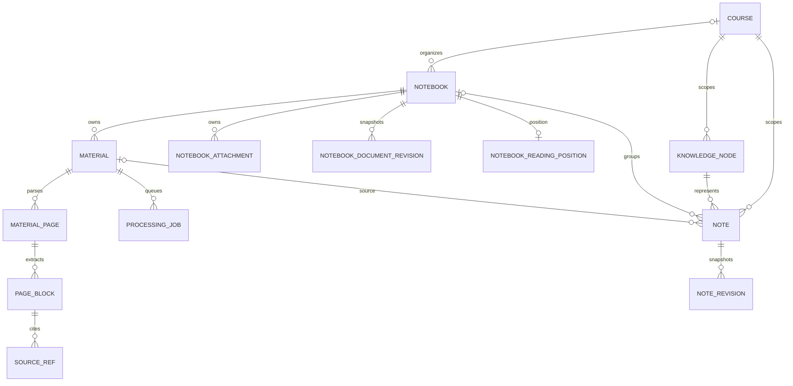

# NoteBuddy 数据架构调查报告

调查日期：2026-10-26

范围：当前 checkout 的提交代码、未提交工作区代码、迁移定义、前端 API 和本机 SQLite 的只读 schema 元数据。未读取笔记正文/附件内容、密钥或配置凭据；未执行迁移或写入数据库。

## 重要状态说明

本次 checkout 的 HEAD 是 `e4585aa32c714f8470eaf129d89ac45bac9f745b`（`redesign：更新笔记卡片设计`）。工作区并不干净：报告撰写前已经有 14 个已修改文件和两条未跟踪迁移文件。这些改动来自本次任务之前的工作，调查期间没有修改它们。

工作区 ORM 与本机数据库不一致：本机 `data/notebook.sqlite3` 的 Alembic revision 是 `b29f17c5a640`；本地 ORM 工作树已移除 `materials.course_id`、`notebook_attachments.course_id` 并增加 `notebook_relations`；新增迁移 `a4c8e1d2f609`、`b7c2e5a910df` 都是未提交文件，且本机数据库没有升级到它们。故本文同时标注“HEAD 已提交实现”“未提交工作区实现”“本机 SQLite 实际 schema”。本机 SQLite 只通过 `mode=ro` 查询了表/列和有限外键元数据。

状态标签含义：

- **已实现（HEAD）**：代码已在当前 HEAD 中。
- **未提交（工作区）**：只在本地未提交代码中出现，不能当作已交付或已落库功能。
- **测试/Mock**：测试样本或 mock，不代表生产数据流。
- **未实现**：当前代码中未发现对应实现。
- **待确认**：仅从当前源码无法确认运行环境是否启用或已有真实生产数据。

## 1. 当前技术栈与项目架构

| 层 | 当前代码证据 | 结论 |
|---|---|---|
| Web | `apps/web/package.json` 范围：React `^19.1.1`、TypeScript `~5.9.2`、Vite `^7.1.7`、React Router `^7.18.4`；lockfile 锁定 React 19.3.0、TS 5.9.3、Vite 7.3.6 | React SPA；入口 `src/main.tsx`、路由 `src/App.tsx`。 |
| 编辑器 | package 声明 Tiptap React `^3.32.0`；lockfile 为 3.32.0；同时使用 StarterKit、image、list、table、mathematics 扩展 | 基于 Tiptap / ProseMirror 的结构化编辑器，见 `apps/web/src/features/notebook-editor/`。 |
| API | `apps/backend/pyproject.toml`：Python `>=3.12`、FastAPI `>=0.115.0`、SQLAlchemy `>=2.0.36`、Alembic `>=1.20.0`、Uvicorn；`uv.lock` 锁定 FastAPI 0.142.2、SQLAlchemy 2.1.3、Alembic 1.20.0、Uvicorn 0.54.0 | FastAPI JSON/multipart API，SQLAlchemy ORM；迁移位于 `apps/backend/migrations/versions/`。锁文件版本不保证线上部署与本地环境完全一致。 |
| 数据库 | `app/db/database.py` 与 `app/core/config.py` | 默认是本地 SQLite 文件 `data/notebook.sqlite3`；工作区可用 `NOTEBOOK_DATA_DIR` 改目录。不是云数据库配置。SQLite 开启外键、WAL 和 busy timeout。 |
| 原始文件 | `app/core/config.py`、`app/services/uploads.py`、`app/notes/attachments.py` | 一般资料写入 `data/originals/`；笔记图片附件写入 `data/notebook-attachments/<notebook_id>/`；封面另存 `data/notebook-covers/`。文件字节不放 SQL 数据库。 |
| AI | `app/ai/deepseek.py`、`app/ai/orchestrator.py`、`app/knowledge/extractor.py`、`app/workers/material_worker.py` | 通过 HTTP 调用配置的 DeepSeek Chat Completions API；联网搜索另有 Tavily 客户端。AI 秘钥只从 settings 读取，本报告不输出任何值。 |
| 异步处理 | `app/workers/runner.py`、`app/workers/material_worker.py`、`app/forest/jobs.py` | 本地独立 worker 轮询 `processing_jobs` 和 `forest_jobs`，不是 FastAPI 请求内完成解析。运行方式与“队列是否运行”取决于外部启动进程，源码无法证明当前服务状态。 |

主要目录：`apps/web/src/pages/` 是页面；`features/notebook-editor/` 是笔记编辑器与自动保存；`src/api/` 是浏览器 API 封装；`apps/backend/app/api/v1/` 是路由；`db/` 是 ORM 与迁移启动逻辑；`parsers/` 是文件抽取；`knowledge/` 负责课程知识节点、笔记和关系提取；`retrieval/` 负责向量/检索块；`services/` 处理上传、删除、历史、备份等。

## 2. 数据库 Schema 与实体关系图

### 2.1 当前实体主干

HEAD 提交代码的主干是：



图按 HEAD ORM 的关系概念绘制。未提交工作区额外加入 `NOTEBOOK_RELATION`，并把 `Material.course_id` 从工作树 ORM 中移除；这两个变化尚未提交、也未进入本机 SQLite。

### 2.2 用户、课程、笔记实体

- **用户表：未实现。** 在当前 ORM 和已提交迁移中没有 `User` 表、用户主键或 owner 外键；搜索后端 `user_id` / `owner_id` 也未发现业务隔离逻辑。应用当前是本地单用户数据模型，不应描述为多用户安全隔离。
- **`courses`**：`id` UUID 字符串主键；`name` 必填；`description`、`deleted_at`、`last_opened_at` 可空；`notebook_order_revision` 默认 0。Course 是组织层，不含 Notebook 正文。
- **`notebooks`**：`id` UUID 字符串主键；`course_id` 可空，FK 到 `courses.id ON DELETE SET NULL`；`title` 必填；排序字段 `display_order`、`tree_slot`、`order_revision`；正文 `document_json TEXT NOT NULL`；`document_revision`；封面 `cover_filename` / `cover_mime`；软删除 `deleted_at`；`is_default`；`next_note_slot`；创建/更新时间。
- 约束：`UNIQUE(course_id, tree_slot)`；SQLite 部分唯一索引限制每课程一个 `is_default=1`。单列 `course_id=NULL` 时 SQLite 的唯一语义允许多条空值，这是支持 unbound Notebook 的一部分。
- **`notes`**（旧/知识树笔记）：独立于 Notebook 的另一套笔记实体。包含 `id`、必填 `course_id`、可空 `notebook_id`、`tree_slot`、必填 `knowledge_node_id`、可空 `material_id`、`section_key/order`、`title`、`content_markdown`、`content_origin`、`user_locked`、`revision_number`、时间戳。FK 对应 course cascade、knowledge node cascade、material set null、notebook 无显式删除动作。唯一键 `UNIQUE(material_id, section_key)`。
- **未提交工作区**：增加 `notebook_relations`，字段 `id`、`source_notebook_id`、`target_notebook_id`、`relation_type`、`description`、`created_at`；两端 FK 删除 notebook 时级联；禁止自关联；`UNIQUE(source_notebook_id,target_notebook_id,relation_type)`。API 在工作区有 GET/POST/DELETE，但不是 HEAD 功能，也不在当前实际数据库里。

### 2.3 文件、解析、生成及相关表

以下字段清单根据当前工作树 ORM `apps/backend/app/db/models.py` 和 `forest_models.py`。注意：实际数据库仍在旧 migration `b29f17c5a640`，其差异单独列于 8 节。

| 表 | 字段（主键标为 PK；`?` 表示 nullable） | 关键约束/关系 |
|---|---|---|
| `materials` | `id PK`, `notebook_id`, `lecture_title`, `topic_title?`, `original_filename`, `stored_filename`, `media_type?`, `size_bytes`, `status`, `page_count`, `created_at`, `content_hash?`, `parser_version?`, `document_warning?`, `deleted_at?`, `chapter_order` | 工作树 FK `notebook_id → notebooks.id ON DELETE CASCADE`，notebook_id 非空；无 course_id 列。唯一性没有内容级唯一约束，重复检测在上传服务中按 notebook+hash 查询。 |
| `notebook_attachments` | `id PK`, `notebook_id`, `original_filename`, `stored_filename`, `mime`, `size_bytes`, `created_at` | FK notebook cascade；工作树无 course_id。当前附件实现限制图片 MIME。 |
| `material_pages` | `id PK`, `material_id`, `page_number`, `title?`, `raw_text`, `parse_status`, `warning?`, `location_type`, `location_label?`, `stable_location_key?`, `extraction_method`, `confidence?`, `is_active` | FK material cascade；活跃/历史解析页使用 `is_active` 区分。 |
| `page_blocks` | `id PK`, `page_id`, `block_type`, `content`, `position`, `font_size?`, `is_bold`, `object_id?`, `location_label?`, `extraction_method`, `confidence?`, `warning?` | FK page cascade；解析文本、表格等块。 |
| `processing_jobs` | `id PK`, `material_id`, `kind`, `status`, `progress`, `error_message?`, `phase`, `web_search_status`, `created_at`, `updated_at`, `error_code?`, `attempt_count`, `idempotency_key?`, `started_at?`, `finished_at?`, `heartbeat_at?` | material 删除级联；唯一活动任务部分索引；幂等键唯一索引。 |
| `notebook_document_revisions` | `id PK`, `notebook_id`, `revision`, `schema_version`, `document_json`, `origin`, `created_at` | FK notebook cascade；`UNIQUE(notebook_id,revision)`。 |
| `notebook_reading_positions` | `notebook_id PK`, `chapter_id?`, `note_id?`, `mode`, `section_offset`, `revision`, `updated_at` | notebook_id FK cascade；chapter_id/note_id 当前不是外键。 |
| `source_refs` | `id PK`, `page_block_id`, `source_type`, `quote`, `status`, `target_label?`, `parser_version?`, `created_at` | FK page_block cascade；通过 `note_source_refs` / `knowledge_node_source_refs` 多对多连接笔记/知识节点。 |
| `web_sources` | `id PK`, `course_id`, `material_id?`, `knowledge_node_id?`, `title`, `url`, `site_name`, `snippet`, `search_query`, `score?`, `published_at?`, `retrieved_at` | course cascade；material cascade；knowledge node set null。 |
| `knowledge_nodes` | `id PK`, `course_id`, `name`, `summary?`, `status`, `created_at`, `updated_at` | course cascade；`UNIQUE(course_id,name)`。 |
| `knowledge_edges` | `id PK`, `course_id`, `source_node_id`, `target_node_id`, `relation_type`, `confidence?`, `created_by`, `created_at` | course 和两端知识节点删除级联；`UNIQUE(source_node_id,target_node_id,relation_type)`。 |
| `retrieval_chunks` | `id PK`, `course_id`, `page_block_id`, `text`, `embedding_json?`, `embedding_model?`, `created_at` | course/page block 删除级联；page_block_id 唯一（一块一索引行）。 |
| `note_revisions` | `id PK`, `note_id`, `revision_number`, `content_markdown`, `content_origin`, `user_locked`, `created_at` | FK note cascade。 |
| `note_suggestions` | `id PK`, `note_id`, `proposed_markdown`, `source_ids_json`, `impact`, `status`, `created_at`, `reviewed_at?` | FK note cascade；用于建议审核。 |
| `knowledge_proposals` | `id PK`, `course_id`, `material_id?`, `source_node_id?`, `target_node_id?`, `kind`, `candidate_name`, `candidate_summary`, `confidence`, `rationale`, `source_ids_json`, `proposed_delta_json`, `status`, `model_version?`, `review_note?`, `created_at`, `reviewed_at?` | course cascade；material/node 被删时 set null。 |
| `knowledge_changes` | `id PK`, `course_id`, `proposal_id?`, `node_id?`, `change_type`, `before_json`, `after_json`, `reason`, `created_at` | course cascade；proposal/node set null。 |
| `provider_calls` | `id PK`, `provider`, `operation`, `status`, `course_id?`, `material_id?`, `model?`, `request_units?`, `response_units?`, `estimated_cost_usd?`, `duration_ms?`, `error_type?`, `metadata_json`, `started_at`, `completed_at?`, `created_at` | course/material 删除 set null；审计元数据应为脱敏概要。 |

### 2.4 其他当前 ORM 表（完整表名和字段）

| 表 | 全部 ORM 字段 | 主外键/主要唯一约束 |
|---|---|---|
| `courses` | `id, name, description, created_at, deleted_at, notebook_order_revision, last_opened_at` | PK `id` |
| `notebooks` | `id, course_id, title, display_order, order_revision, document_json, document_revision, cover_filename, cover_mime, deleted_at, is_default, tree_slot, next_note_slot, created_at, updated_at` | PK；course FK set null；课程槽唯一；课程默认本唯一（SQLite 部分唯一索引） |
| `notes` | `id, course_id, notebook_id, tree_slot, knowledge_node_id, material_id, section_key, section_order, title, content_markdown, content_origin, user_locked, revision_number, created_at, updated_at` | course/node cascade；material set null；`UNIQUE(material_id,section_key)` |
| `conversations` | `id, course_id, title, default_scope, scope, note_id, note_title, created_at, updated_at` | course cascade；会话 note_id 是无 FK 的历史/作用域字段 |
| `conversation_messages` | `id, conversation_id, role, content, learning_goal, status, model_version, failure_type, idempotency_key, created_at` | conversation cascade；`UNIQUE(conversation_id,idempotency_key)` |
| `message_evidence` | `id, message_id, source_ref_id, web_source_id, claim_key, evidence_type, support_level, created_at` | message/source/web 删除 cascade |
| `feedback` | `id, course_id, target_type, target_id, category, comment, status, resolution, created_at, updated_at` | course cascade；`UNIQUE(course_id,target_type,target_id,category)`；target_id 没有多态外键 |
| `backup_records` | `id, course_id, action, path, status, manifest_json, error_message, created_at, completed_at` | course set null |
| `forest_course_profiles` | `course_id, semester, level, learning_state, position, revision, prerequisites_json` | course_id 是 PK + cascade FK |
| `forest_jobs` | `id, kind, course_id, curriculum_import_id, status, progress, error_message, attempt_count, idempotency_key, source_snapshot_json, completed_source_count, created_at, updated_at, started_at, finished_at, heartbeat_at` | course/import cascade；idempotency 唯一索引 |
| `curriculum_imports` | `id, filename, stored_filename, input_text, status, mode, warnings_json, rows_json, error_message, created_at, confirmed_at` | PK；无 course 外键，导入任务与课程通过其他逻辑关联 |
| `cross_course_relations` | `id, source_course_id, target_course_id, source_note_id, target_note_id, source_revision, target_revision, relation_type, reason, status, origin, activation_mode, evidence_fingerprint, source_ref_ids_json, target_ref_ids_json, created_at` | 两课程、两笔记均 cascade；`UNIQUE(source_note_id,target_note_id,relation_type)` |
| `note_source_mappings` | `id, note_id, source_ref_id, fragment_key, citation_type, status, parser_version, created_at` | note/source cascade；组合关系由应用维护 |
| `note_source_refs` | `note_id, source_ref_id` | 复合 PK；note/source cascade |
| `knowledge_node_source_refs` | `knowledge_node_id, source_ref_id` | 复合 PK；node/source cascade |

**实际 SQLite 差异**：只读 schema 显示当前库 revision `b29f17c5a640`，`materials` 仍有 `course_id`（ON DELETE CASCADE）与 `notebook_id`（实际 FK 未声明删除动作），`notebook_attachments` 仍有 `course_id`（ON DELETE SET NULL）与 `notebook_id`（ON DELETE CASCADE），且当前库没有 `notebook_relations`。其余用户数据库字段级内容没有读取。

迁移定义从 `964d70a06320_initial_schema.py` 开始；经历 course notebooks、多 notebook、unbound notebook/document、history/attachments、知识森林、自动关系等迁移。`d0a6f3c9b812` 与 `b29f17c5a640` 是既有迁移合并点。本地数据库应用 revision 为 b29。工作树的新迁移链将 `a4c8e1d2f609`（新增 notebook_relations 并合并迁移支线）和 `b7c2e5a910df`（资料改由 notebook 拥有、去除 course 列）放在其后；两者未提交且未在本机数据库执行。

## 3. Notebook 当前数据模型

### 创建与读取

- Unbound 创建：`POST /api/v1/notebooks/unbound` → `create_unbound_notebook`，生成一个 `Notebook(course_id=NULL,title,tree_slot=0,is_default=false)`，正文由数据库默认值空 JSON 初始化。课程内创建：`POST /api/v1/courses/{course_id}/notebooks` → `create_notebook`。
- 唯一 ID：`app/db/model_utils.py::new_id` 生成 UUID 字符串；ORM 主键列长度 36。
- 读取：unbound 使用 `/notebooks/unbound/{id}` 和 `/document`；课程笔记主要使用 `/courses/{course_id}/notebooks/{notebook_id}` 和 `/document`。课程旧路由 `/courses/{course_id}/notebook` 仍保留，调用默认 Notebook。

### 标题、正文和保存

- 标题单独存 `notebooks.title`，经 `PATCH` notebook 或 unbound rename 更新；不嵌在正文文档内。
- 主编辑器正文存 `notebooks.document_json TEXT`，版本号 `document_revision`。旧 `notes.content_markdown` 是 AI 知识树中按课程/知识节点拆分的另一类记录，不等同 Notebook 主正文。
- API 接受文档 v2：`NotebookDocumentUpdate` 带 `content` 和 `expected_revision`；服务校验/标准化后做 revision 条件更新，成功时 `record_snapshot` 写历史，再提交数据库事务。revision 不匹配返回 409。
- 前端 `useNotebookSave` 使用 850 ms debounce 自动提交；500 ms 延后写本地 IndexedDB/local draft（`draftStore.ts`）；离开页面前提示未保存。失败可重试；409 打开冲突流程。本地草稿不是服务端版本历史。
- 历史 `notebook_document_revisions` 最多保存最近 100 个 revision 且不保留超过 90 天；API 可列出、读取和恢复。恢复会生成新的 revision。

### 删除及附件

课程 Notebook 的 DELETE 目前是软删除：检查仍在处理的资料任务，创建 checkpoint，再设置 `deleted_at`，保留数据库与附件文件；提供回收站列表/恢复接口。课程本身也采用软删除服务并将 Notebook 解绑。故“删笔记后立即清理附件”并不是当前行为。

附件清理 worker 每小时检查图片附件：若当前文档和保留的历史快照都不再引用附件，超过一天宽限期后删除对应文件和数据库行；删笔记目录有独立延迟清理任务。清理逻辑位于 `app/notes/attachments.py` 和 `app/workers/runner.py`。普通 `materials` 原文件在资料软删除时不立即清除；其备份/保留与删除流程由 `services/deletion.py`、checkpoint 控制。

## 4. 编辑器正文 JSON 结构

编辑器是 Tiptap / ProseMirror JSON，而非纯 Markdown、HTML 或自定义文件格式。后端 `app/notes/document.py` 定义 `SCHEMA_VERSION=2`、白名单节点/属性及严格校验；数据库保存包裹结构：`{"schema_version":2,"doc":<Tiptap doc>}`。读取端同时兼容早期裸 `doc` 和旧 `[{id,type,text}]` blocks（按需转换，不在读取时覆盖原值）。

支持节点/能力（由前端扩展和后端校验共同体现）：段落、heading（编辑工具直接提供 H1/H2，Schema level 可到 3）、bullet/ordered/task list、blockquote、codeBlock、horizontalRule、table、callout、example、image、行内/块级数学公式；文本 mark 包括 bold、italic、underline、strike、link、code、highlight。图片支持宽高等属性。具体实现：`features/notebook-editor/extensions.ts`、`NotebookEditor.tsx`、`app/notes/document.py`。

结构示例（`attachmentId` 与服务端附件记录对应；ID/正文示例为说明数据，不代表数据库真实内容）：

```json
{
  "schema_version": 2,
  "doc": {
    "type": "doc",
    "content": [
      {
        "type": "heading",
        "attrs": { "level": 1, "blockId": "heading-a1" },
        "content": [{ "type": "text", "text": "光的干涉" }]
      },
      {
        "type": "paragraph",
        "attrs": { "blockId": "paragraph-a1" },
        "content": [{ "type": "text", "text": "两列相干光叠加形成干涉。" }]
      },
      { "type": "blockMath", "attrs": { "latex": "\\Delta = k\\lambda" } },
      {
        "type": "image",
        "attrs": {
          "src": "/api/v1/notebook-attachments/attachment-id",
          "attachmentId": "attachment-id",
          "alt": "干涉示意图"
        }
      }
    ]
  }
}
```

编辑器从 GET document API 取得 JSON，`normalizeDocument` 后以 Tiptap `setContent` 加载；编辑器 `onChange` 返回 JSON，自动保存调用 PUT。图片流程先单独 multipart 上传，拿到 URL/attachment ID 后插入 image 节点，再随正文 JSON 保存。

## 5. 原始文件和 AI 生成资源的存储机制

### 原始材料文件

- HEAD：课程材料上传 `/api/v1/courses/{course_id}/materials`，表 `materials` 同时存 course_id 和可空 notebook_id；路径默认为 `data/originals/<material UUID>.<ext>`，数据库只存 `stored_filename`。
- 工作树未提交：新增 `/api/v1/notebooks/{notebook_id}/files`，ORM 将 `materials.notebook_id` 设必需并从 model/migration 移除 course_id；新迁移 `b7c2e5a910df` 未在真实本地库应用。工作树当前上传仍写 `data/originals/` 平铺目录，物理路径不是按 Notebook 分目录。
- 有 `content_hash`（SHA-256）用于同一 Notebook 重复上传检查；记录文件名、MIME、大小、状态。不是通用附件资源表。
- 当前允许的可解析后缀默认 `.pptx,.pdf,.docx`；图片不能通过材料 parser 上传接口，走图片附件接口。

### 图片附件与封面

- 图片 `NotebookAttachment` 有附件 UUID、notebook_id、原名、存储名、MIME、字节数、时间。文件按 notebook 目录保存在 `data/notebook-attachments/<notebook UUID>/<random>.<ext>`。接受 PNG/JPEG/WebP/GIF，单文件最多 10 MB；MIME 依据字节签名检查。
- 封面是 `notebooks.cover_filename/cover_mime` 加 `data/notebook-covers/` 文件，没有独立附件表或封面统一资源 ID。
- 图片附件是用户插入正文的图片，并非 AI 绘图结果。当前未发现 AI 生成 PNG/SVG/JPG 的独立生成或资源管理流水线。

### 访问与删除边界

附件 GET 用 opaque attachment ID 返回 `FileResponse`；保存正文时校验 attachment ID 属于当前 notebook。GET 端点按 ID 查记录并检查路径/文件是否存在，但没有用户 ID、owner 或登录权限验证。Course/Notebook 路由校验 UUID 对应的课程归属，但这是对象归属校验，不是用户授权。

## 6. 文件解析与 AI 生成数据流

```text
浏览器文件选择
  → POST multipart 上传
  → 上传服务校验扩展名/大小/容器并写 data/originals
  → materials 行 + processing_jobs 行
  → runner 原子领取 job
  → PDF/PPTX/DOCX parser
  → material_pages + page_blocks
  → AI knowledge extractor（课程上下文）
  → knowledge_nodes / notes Markdown / source_refs / proposals
  → retrieval_chunks（向量配置可选）
  → 完成状态经 jobs API 返回前端
```

### 已实现的解析能力

- PDF：`pypdf` 提取文本层，按页保存；空文本页标记 OCR candidate。不从扫描页臆造文字。
- PPTX：`python-pptx` 按 slide/shape 抽文本和版式线索，有页脚过滤等规则；不等同完整 Office 渲染/媒体解包。
- DOCX：`python-docx` 按文档顺序提取段落和表格文本；文档图片只记录为不可用 image block 提示，未抽取图像内容。
- OCR：PDF 页 OCR 接口可排队；`parsers/ocr.py` 提供可选后端状态/调用。实际是否可用取决于本地 OCR 依赖/设置；仅支持 PDF 扫描页路径。公式 OCR、手写识别没有独立承诺。
- 表格：DOCX 表格按单元格文本拼成 block；PPTX 图表或复杂布局不能据此保证精确还原。公式通常只有当原生文本层中包含可抽取字符时才保留，未发现专门数学公式对象解析。
- PNG/JPG：作为 notebook 图片附件显示/插入；不进入 `parse_document`，没有图片内容 OCR/视觉理解流程。

### AI 结果及覆盖保护

- `knowledge/extractor.py` 调用 `extract_page_draft`，提示模型按 JSON 返回 title、summary、key_points、methods、formulas、relations；目前产物主要转成 `notes.content_markdown`，知识节点/关系/来源证据另表保存，不写成 Notebook v2 JSON 主文档。
- 用户编辑旧 `Note` 会设 `content_origin='user'`、`user_locked=true` 并写 `note_revisions`；AI 更新使用 proposals / suggestions 审核路径。AI 助手对选中文本会将建议/流式文本送前端，NotebookBridge 可插入正文，但必须由用户操作；不见自动覆盖整份 Notebook JSON 的路径。
- 材料解析任务有 pending/processing/completed/failed、progress、phase、attempt_count、heartbeat、retry、reparse、OCR 等；API 有重试/重新解析，没有面向材料任务的取消端点。重解析保留旧页为 inactive/stale evidence。
- 未提交工作区的 worker 对 `material.course_id is None` 只完成文件解析然后标记 completed，跳过课程知识提取、联网搜索和课程检索索引。此行为不在 HEAD，且当前保存 AI 知识仍是 course-scoped。

## 7. 前后端 API 清单

### Notebook 与正文

| API | 功能 | 状态 |
|---|---|---|
| `POST /api/v1/notebooks/unbound` | 创建独立/未分类 notebook | HEAD |
| `GET/PATCH /api/v1/notebooks/unbound/{id}` | 读/改标题 | HEAD |
| `GET/PUT /api/v1/notebooks/unbound/{id}/document` | 读/保存正文 JSON | HEAD |
| `GET /api/v1/notebooks/{id}/revisions...`、`POST .../restore` | unbound 历史版本 | HEAD |
| `POST /api/v1/notebooks/{id}/bind`、`.../unbind` | 将 notebook 绑定/解绑课程 | HEAD |
| `GET/POST /api/v1/courses/{course_id}/notebooks` | 列表/创建课程下 notebook | HEAD |
| `GET/PATCH /api/v1/courses/{course_id}/notebooks/{id}` | 读取/改名课程 notebook | HEAD |
| `GET/PUT /api/v1/courses/{course_id}/notebooks/{id}/document` | 读写正文 v2 JSON | HEAD |
| `DELETE /api/v1/courses/{course_id}/notebooks/{id}` | 软删除 notebook | HEAD |
| `GET/POST/DELETE /api/v1/notebooks/{id}/relations...` | notebook 间 typed link | 未提交工作树；实际 DB 尚无 relation table |

### 文件、解析与其他数据

| API | 功能 | 状态 |
|---|---|---|
| `POST/GET /api/v1/courses/{course_id}/materials` | 课程资料上传/列表 | HEAD |
| `GET /api/v1/courses/{course_id}/notebook-files` | 按课程 notebook 汇总资料和图片附件 | 未提交工作树；HEAD 中没有该接口 |
| `GET/POST /api/v1/notebooks/{notebook_id}/files` | notebook 资料列表/上传 | 未提交工作树；迁移未应用，前端仅 API client 已增加方法，未分类笔记页尚未提供该 UI |
| `POST /api/v1/courses/{course_id}/notebooks/{id}/attachments`、unbound 对应路由 | 上传正文图片 | HEAD |
| `GET /api/v1/notebook-attachments/{attachment_id}` | 读取图片附件 | HEAD |
| `POST /api/v1/materials/{id}/retry|reparse|ocr` | 排队重试/重解析/OCR | HEAD |
| `GET /api/v1/materials/{id}/pages...`、`coverage`、`web-sources` | 解析页/证据/覆盖率/联网来源 | HEAD |
| `GET /api/v1/jobs/{job_id}` | 查询材料任务状态 | HEAD |
| `GET/PATCH /api/v1/courses/{id}/notes`、`/api/v1/notes/{id}` | 旧知识树 Note 查询/修改 | HEAD |
| `/api/v1/assistant/...`、`/api/v1/agent/...` | 课程助手和工具/SSE | HEAD；仍以 course_id 上下文为主 |

其余课程、知识树、对话、备份、课程导入等路由在 `app/api/v1/routes.py` 注册。路由存在不代表外部 provider/worker 在当前运行环境已配置或正常工作。

## 8. 现有设计中的数据一致性及冗余风险

1. **两套笔记内容模型并存。** `Notebook.document_json` 是自由编辑的整篇正文；`Note.content_markdown` 是 AI 从课程页提取的知识点笔记，附带 `knowledge_node_id`、course_id、material_id。标题/正文编辑、版本历史、AI 生成和检索分散在两套实体。
2. **HEAD 与未提交 ORM、数据库不同步。** HEAD/本机库 `materials.course_id` 必填且 attachment 有 `course_id`；工作树模型删掉两处 course 列，新 migration 未落库。若用当前未提交代码直接启动连接旧数据库，应用模型期望与数据库列不一致，需先评估迁移兼容并执行迁移；本任务未执行。
3. **文件归属在 HEAD 冗余。** 同一材料行同时存 course_id 和 notebook_id；附件也有二者。课程绑定变化时需同步两处，可能漂移。未提交工作区以 notebook 为唯一 owner，course 由 notebook 派生，但尚未实库升级。
4. **解析阶段的 ID 粒度是 Material/Page/Block。** ProcessingJob 关联 material；解析结果不是一组通用 Notebook Asset。用户原始图片附件走另一张表和完全不同的路径/清理逻辑。
5. **生成结果不是单一可编辑 Notebook 文档。** AI 输出先落在 course knowledge/note/proposal/source 表，Notebook JSON 与 AI 生成内容之间没有统一资源索引/版本关系。
6. **硬删除/级联与软删除并行。** Course/Notebook/Material APIs主要软删除；数据库 FK 中一些 cascade 仅在硬删除发生时生效。附件文件系统清理依赖定期 worker，数据库级联本身不删物理文件。
7. **权限缺口。** 没有 user/owner 外键或用户认证依赖；opaque UUID 路由不构成访问控制。多用户部署前需确认隔离要求。
8. **外键删除动作不完全统一。** Notebook 的 `course_id` 是 `ON DELETE SET NULL`；材料/附件 notebook FK cascade；Note 有 course cascade 且 notebook FK 未指定 cascade；多表同时保存 course_id 和 notebook_id 时依赖应用同步。
9. **物理资料路径没有按 Notebook 层级组织。** `materials.stored_filename` 指向 `data/originals` 根目录；只有 image attachments 子目录按 Notebook 划分。数据库 ownership 与磁盘目录布局不一致。

## 9. 当前缺失的功能

- **用户数据和权限：未实现。** 无 User 表、用户认证/授权或 owner_id。
- **Notebook 通用文件资产注册表：未实现。** PDF/PPTX/DOCX 进 Material；图片进 NotebookAttachment；封面存列+文件；AI 图片没有实体。
- **Notebook 主文档的 AI 生成持久化：未实现为统一流程。** 课程知识 Note 使用 Markdown 和独立表，不直接保存到 Notebook JSON 的可审计 AI 版本；工作区 unbound 文件不做知识提取。
- **PNG/JPG 上传后的 OCR/视觉解析：未实现。** 编辑器图片可存储和引用，但不提取知识内容。
- **AI 生成图片/SVG 生命周期：未实现。** 没有 AI 图像任务、模型调用、资源存储元数据和前端资源列表。
- **面向 Notebook 的解析任务：未实现统一抽象。** 现任务外键指向 Material；任务取消 API 未实现。
- **文件权限读取：未实现用户级权限校验。** 图片 GET 校验路径安全，不验证请求用户是否可访问 notebook。
- **未分类笔记 UI 的通用文件上传列表：未提交 API client 有调用方法，但页面未接入，属于未接入功能。** 图片插入 UI 已接通附件 API。
- **Mock 说明：** 生产 `src/` 中没有发现统一假数据层；`apps/web/tests/` 包含大量 Vitest mock/stub 响应，这些只用于测试。具体测试不代表 API 已在运行环境联通。当前无法据静态代码判断部署配置中哪些外部服务已启用（待确认）。

## 10. 针对目标 Notebook 架构的兼容性分析

### 可复用的现有基础

- Notebook 已有稳定 UUID、独立正文 JSON、revision CAS 保存、历史快照、软删除和 unbound 形态。
- 图片附件已经按 notebook 归属，正文通过 `attachmentId`/URL 引用；course 可以为空。
- 材料解析结果存在页面/块层级，任务可重试、记录解析器版本和来源证据。
- 知识点、关系、引用、用户编辑锁定和建议审核机制可作为目标知识内容/来源系统的复用材料。

### 主要缺口

- 目标希望 Notebook 同时统一管理正文、各类原始文件、解析输出、AI 资源和任务；当前只有正文/历史与“图片附件”直接挂在 Notebook，材料和解析从 Material 出发，AI 知识产物从 course 出发。
- 当前编辑器文档 Schema 没有通用 file/resource node（只有 image attachment node），表格、公式等是正文节点；AI 生成图片/公式/块没有资源 ID/来源/任务绑定。
- Notebook 与 Course 可选关系已存在；HEAD 下材料却仍存 course_id。工作树 migration 计划移除，然而本机 DB 仍旧结构。
- Notebook 与 Notebook 的 typed relation 只有未提交模型/API/migration，不是现有实际 schema。
- `notes` 等关联的 course_id 约束说明 course-level AI知识系统无法直接承载未分类 Notebook；未分类 Material worker 当前只能解析原文并停在不生成课程知识的路径。

## 11. 现有架构与目标架构差异清单

| 领域 | 当前（提交/真实数据库） | 目标 | 差异 |
|---|---|---|---|
| 核心实体 | Notebook 主正文与 Knowledge Note 并存 | Notebook 是唯一核心学习笔记实体 | 需要确定旧 `notes` 知识节点如何映射/承载到 Notebook 文档 |
| 课程关系 | Notebook 可无课程；Material/Attachment 在 DB 仍带 course_id | Course 只是 Notebook 可选分组，文件通过 Notebook 间接归组 | HEAD 强耦合；工作树未提交迁移正在移除此依赖 |
| 原始文件 | Material 文件和图片附件两套表/目录 | Notebook 统一管理 PDF/PPTX/DOCX/PNG/JPG 等 | 需统一元数据/文件访问/删除/哈希/类型策略 |
| JSON 正文 | Tiptap JSON v2，位于 notebooks.document_json | 支持正文文本、公式、图片引用及 AI 内容 | 基础兼容；缺少资源引用类型、AI来源/版本嵌入策略 |
| AI 知识 | course-scoped knowledge_nodes + markdown notes + proposals | 每篇 Notebook 可独立生成/编辑 AI 知识内容 | unbound 不完整，AI 内容不在 Notebook JSON 主记录 |
| AI 图片 | 未实现 | SVG/PNG 等 AI 资源可保存并引用 | 新能力 |
| 任务 | `processing_jobs.material_id` 和课程森林任务 | 任务按 Notebook/Asset 关联、可追溯、可取消 | 调度外键和 API 需扩展 |
| 历史 | Notebook 正文最多 100 条/90 天；旧 Note 另有 revision | 正文、AI块、资源变化可追踪 | 现有 history 分裂成两套，文件/AI资源版本无统一 history |
| 关系 | 课程内知识图和跨课程 Note relations；Notebook typed link 仅工作树未提交 | 独立 Notebook 可互相引用且归属不变 | 设计/DB 状态尚未交付一致 |
| 多用户 | 没有用户表/授权 | 若未来多用户需按用户隔离 Notebook 和资产 | 尚无 owner 和 access policy |
| 存储 | SQLite 元数据 + 本地文件系统 | Notebook 统一元数据和可迁移资源存储 | 当前两种文件路径体系；对象存储未接入 |

### 关键代码定位

- ORM：`apps/backend/app/db/models.py`（Course/Notebook/Material/Note 等类）；课程/森林附属模型：`apps/backend/app/db/forest_models.py`。
- Notebook API：`apps/backend/app/api/v1/notebook.py`；文件/解析 API：`apps/backend/app/api/v1/materials.py`；旧 Note API：`apps/backend/app/api/v1/notes.py`。
- 文档契约：`apps/backend/app/notes/document.py`；前端 schema/转换：`apps/web/src/features/notebook-editor/document.ts`。
- 自动保存：`apps/web/src/features/notebook-editor/useNotebookSave.ts`；编辑器：`apps/web/src/features/notebook-editor/NotebookEditor.tsx`、`extensions.ts`。
- 文件和任务：`apps/backend/app/services/uploads.py`、`app/notes/attachments.py`、`app/workers/material_worker.py`、`app/workers/runner.py`。
- 当前真实库 revision：只读查询 `data/notebook.sqlite3` 的 `alembic_version` 得到 `b29f17c5a640`；ORM/migration 状态可能在未提交代码变化后再次变化，本文只代表调查日 checkout。
