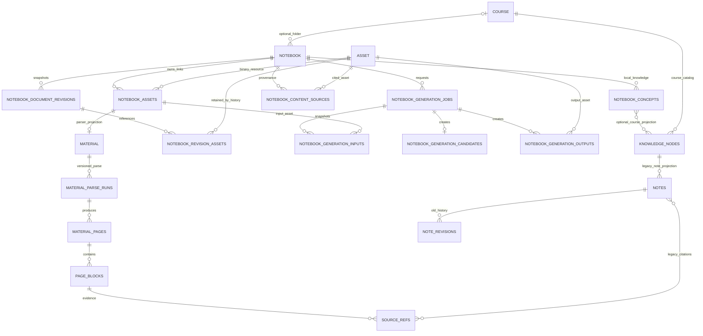
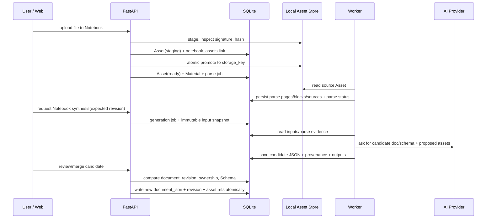

# NoteBuddy 第二阶段：Notebook 数据架构设计与迁移规划

日期：2026-10-26

性质：设计文档；本轮未修改业务代码、配置或迁移文件，未执行数据库操作。

## 0. 结论摘要

推荐方案 B：保留 Notebook 正文 JSON 与现有解析专属表，在两者之间加入统一的**资源元数据层**（`assets`）和 Notebook 资源关联表（`notebook_assets`）。原始文件、编辑器图片、AI 生成图像都先成为有稳定 ID 的 Asset；`materials` 继续承载 Office/PDF 解析状态，`material_pages` / `page_blocks` 继续保存专门解析结果。图中的长期目标表不等于 P0 一次性建齐；P0 表集和候选图片输出引用以“第二轮评审结果与设计修订记录”为准。

另增 `notebook_generation_jobs` 与 `notebook_generation_candidates`，将“AI 生成候选”与 `notebooks.document_json` 中用户最终确认的正文分开。候选生成绑定基准 `document_revision`、输入资源快照和 Schema 版本；确认时做 revision CAS 和显式合并，永不静默覆盖当前正文。已被正文/历史/候选引用的 Asset 不参与清理。

**迁移顺序前置条件：**分支 HEAD 是 `e4585aa32c714f8470eaf129d89ac45bac9f745b`；当前工作区已有未提交代码和三条未提交迁移：a4c8e1d2f609、b7c2e5a910df、c8f4a2d91b70（第三条 assets 迁移也只是工作区内容）；调查报告记录本机 SQLite revision 为 `b29f17c5a640`。不能把工作树迁移视为已交付或已执行。必须先审查它们，再在数据库副本上验证迁移链，之后才能更新 ORM 与真实库。

## 1. 已确认事实、建议和待产品决策

### 已确认事实

- HEAD 已有独立 `notebooks` 表，`course_id` nullable，Notebook 主正文是 `document_json`，历史表为 `notebook_document_revisions`。编辑器保存 Tiptap v2 JSON，自动保存、revision 冲突和恢复能力已实现。
- HEAD 文件路径分为 `materials`（PDF/PPTX/DOCX）和 `notebook_attachments`（PNG/JPEG/WebP/GIF）两套；封面又是 notebook 列 + 单独目录。数据库中原始文件不存 BLOB。
- HEAD 的 Material/NotebookAttachment 都有课程字段；Notebook 自己可 unbound。AI 知识提取、`notes`、`knowledge_nodes`、检索和大部分助手仍依赖课程上下文。
- 当前工作区未提交 ORM 保留 nullable `materials.course_id` 和 `notebook_attachments.course_id` 作为兼容字段，并新增 Asset/NotebookAsset、图片解析和 Notebook generation 模型；三条工作区迁移为 `a4c8e1d2f609`、`b7c2e5a910df` 和 `c8f4a2d91b70`。这些仍是未提交工作，不是 HEAD 已交付内容；本机 SQLite revision `b29f17c5a640` 仅为上阶段记录，本轮未重新查询。
- 没有用户表、owner_id 或用户认证隔离。当前不能将 UUID 路径当作用户权限校验。

### 本报告的架构建议

- 保留 `notebooks.document_json` 作为用户已确认正文的唯一主存储；不新增并行的正文主表。
- 用 Asset 元数据 + NotebookAsset 关联统一原始资料、正文图片、AI 输出图像和封面；保留 Material 作为 PDF/Office 解析投影。
- 候选文档和任务分开持久化；用户确认后通过现有 revision CAS 写回 Notebook JSON。
- 旧 Note/知识节点/来源证据先保留并桥接，再逐步改变生成与读取路径；没有完成依赖盘点、数据回填和兼容验证前不删除。
- SQLite 和本地文件系统继续作为第一阶段运行基座；所有新路径均为受控相对 storage key。

### 待产品决策

1. Notebook 是否长期最多绑定一门 Course？本文按 `Course 1 : N Notebook`、Notebook `course_id NULL | 一个课程` 设计。
2. 一个原始文件是否允许被多个 Notebook 共享？P0 明确不支持隐式共享，每个已归属 Asset 至多一个有效 owner；跨 Notebook 复用采用复制，显式共享留待 ACL/撤权语义确定后设计。
3. “用户确认”是整份 AI 候选替换、逐块接受，还是同时支持两者？技术方案支持整份候选和基于 blockId 的逐块合并，但 UI 选择需确认。
4. 用户编辑的旧 `notes.content_markdown` 如何纳入 Notebook？推荐保留为知识图谱/历史产物并可导入，不自动覆盖 Notebook 正文；需要确认是否为用户可见内容及导入策略。
5. Notebook 软删除保留期限、历史 JSON/资源保留期限、恢复窗口由产品确认；在此之前使用可配置保留期，禁止立即物理删除。
6. 本地单用户模式是否会部署到共享主机？如果会，必须先设计用户认证、owner FK 和访问策略，不能把本设计的 notebook ownership 当成用户隔离。

## 2. 目标 ER 图



Asset 和关联表的拆分允许资源元数据不等同于正文，也保留从多个 revision/候选追踪引用的能力。P0 明确单 Notebook 所有权，不支持隐式共享：数据库对 `notebook_assets.asset_id WHERE detached_at IS NULL AND is_owner=1` 建唯一索引，保证至多一个有效 owner；有效用途关联必须经服务校验属于该 owner Notebook。历史/候选引用不是第二个 owner。未来共享须有显式授权、跨 Notebook ACL、删除/撤权语义及审计，不能只删唯一约束。

### 表生命周期决策

| 当前实体 | 决策 | 理由/过渡 |
|---|---|---|
| `notebooks` | 保留并扩展 | 主体、Course 可选分组、标题、Tiptap 正文、正文 revision 仍是中心。 |
| `notebook_document_revisions` | 保留并扩展/桥接资源引用 | 继续保存 v2 JSON 快照；新增 revision 与 Asset 的显式引用关系供 GC。 |
| `materials` | 保留、改为解析投影 | 加 `notebook_asset_id`；保留讲次名、状态、hash/解析器版本/页数等解析业务字段，逐步取消它作为原始文件存储主表。 |
| `material_pages`、`page_blocks` | 保留 | 解析证据、稳定位置、OCR 状态、表格/文本块对检索与引用仍有价值。后续可加 `parse_run_id`，不在首迁移删除。 |
| `processing_jobs` | 保留用于文档 Material 解析 | 兼容 worker、旧 API、重试状态；不应与图片 Asset 解析或 Notebook 综合生成混用一个业务主体。 |
| `notebook_attachments` | 兼容保留一段时间，后续停写 | 将附件行和磁盘文件映射到 Asset/NotebookAsset；旧 URL 可适配到 Asset 读取。确认旧正文/历史已关联新资源后才能停止/删除。 |
| `notes`、`note_revisions`、`note_suggestions` | 保留 | 课程知识节点 Markdown 与审核流程暂时继续服务；它们不等同 Notebook 正文。增加明确 notebook provenance 后再评估读路径迁移。 |
| `knowledge_nodes`、`knowledge_edges`、`cross_course_relations` | 保留 | 保持课程概念目录和跨课程知识关系用途；增建 notebook-local concept 关联桥，不把课程目录误作单篇笔记正文。 |
| `source_refs`、映射表、`web_sources`、`retrieval_chunks` | 保留并扩展 provenance | 继续服务旧知识/检索；新正文块以 `notebook_content_sources` 指向 asset/page/block。验证新旧引用一致后再淘汰重复路径。 |
| `notebook_relations` | 条件保留 | 工作树新增、HEAD/数据库未有；先检查 relation 语义是否已产品确认，再合并迁移并补 API/UI。 |
| `courses` | 保留 | 仅作为可选分组和课程知识目录，不再作为文件 owner。 |

## 3. 方案 A / B 比较与推荐

| 维度 | A：保留三套文件机制，小改 | B：`assets` + `notebook_assets`，Material 留作解析投影 |
|---|---|---|
| 数据冗余 | 图片、普通材料、封面分别定义文件名/MIME/大小/路径/删除；三种上传和清理逻辑继续增长 | 文件字节元数据、storage key、hash、MIME、大小统一；业务关系在 notebook_assets；解析字段仍在 Material |
| 迁移复杂度 | 最低；先适配各 API、修改 course FK；但以后加 AI 图片仍需第四套表/路径 | 中到高；需迁移三套旧记录并对账文件存在性、重建链接和引用；必须分步、复制优先 |
| 对现有 API 影响 | 表面最小；每个旧接口内部要维护不同 storage implementation | 可保留旧 URL/响应并改由 adapter 查询资产；新增统一 Notebook assets API，前端可渐进接入 |
| AI 生成图片成本 | 高；给 AI 输出再加独立表/路径和清理规则 | 低；Asset `kind=ai_output`，job 输出关联 Asset，正文引用稳定 asset_id |
| 删除/历史/权限 | 三种类型各自实现 GC，难跨正文历史检查 | 统一通过 active notebook link、revision refs、generation input/output refs 算引用；访问入口集中可校验 Notebook |
| 换存储后端 | 多个 path schema 和业务特例都要迁移 | storage adapter 读取相对 storage_key；将来可把 local 实现替换成别的 backend，不改业务 ID/API |

**推荐 B。** 目标明确包含正文图片、原始文件、AI 资源、引用追溯和统一清理；方案 A 只降低当前一步迁移成本，却把分裂设计永久扩展。B 的复杂度集中在一次可验证的资源迁移，且能保留 `materials/material_pages/page_blocks` 解析专属形态。采用 B 不代表现在就改存储到云端或重写解析器。

## 4. 推荐表与具体字段

以下是设计建议，并非当前已存在 schema。`UUID` 表示 36 字符 UUID 字符串；SQLite 可用 `TEXT`/`VARCHAR(36)`。时间统一 UTC。文件字节仍留本地文件系统。

### 4.1 `assets`：统一资源元数据

| 字段 | 类型/可空 | 约束/用途 |
|---|---|---|
| `id` | UUID NOT NULL | PK；稳定资源 ID，永不由用户文件名构造。 |
| `source_type` | TEXT NOT NULL | 资源如何产生/进入系统：`user_upload`、`ai_render`、`image_model`、`imported`、`system_generated`。与使用场景分离。 |
| `media_type` | TEXT NOT NULL | `document`、`image`、`audio`、`other`，可从校验后的 MIME 派生；不是来源。 |
| `mime_type` | TEXT NOT NULL | 签名校验后的 MIME；不信任客户端声明。 |
| `extension` | TEXT NOT NULL | 由 validated MIME/文件签名映射。 |
| `original_name` | TEXT NULL | 用户展示名；仅元数据，不参与路径。 |
| `storage_key` | TEXT NOT NULL UNIQUE | 受控相对路径，如 `assets/ab/<asset_uuid>.png`；禁止绝对路径和 `..`。 |
| `byte_size` | INTEGER NOT NULL CHECK >= 0 | 资源大小。 |
| `sha256` | CHAR(64) NULL | 内容完整性/重复提示；missing 旧文件允许为空。普通索引，不强制全局唯一，避免跨 Notebook 隐式共享。 |
| `state` | TEXT NOT NULL | 唯一生命周期事实源：`staging`、`ready`、`missing`、`quarantined`、`delete_pending`、`deleted`。 |
| `created_at` | DATETIME NOT NULL | 创建时间。 |
| `verified_at` | DATETIME NULL | 最后校验磁盘存在/哈希时间。 |


索引：`UNIQUE(storage_key)`；`INDEX(sha256,byte_size)`；`INDEX(source_type,state)`。不另设 `deleted_at`，避免双状态源。不在 Asset 上存 `course_id`。如果将来引入 user，再加 owner FK，而不是把 course 当 owner。

### 4.2 `notebook_assets`：Notebook 与资源关联

| 字段 | 类型/可空 | 约束/用途 |
|---|---|---|
| `id` | UUID NOT NULL | PK，稳定 link ID。 |
| `notebook_id` | UUID NOT NULL | FK `notebooks.id ON DELETE CASCADE`。 |
| `asset_id` | UUID NOT NULL | FK `assets.id ON DELETE RESTRICT`；清理前由 GC 明确判定引用。 |
| `role` | TEXT NOT NULL | Notebook 内用途：`source_material`、`inline_image`、`cover`、`other`。AI 来源不属于 role。 |
| `is_owner` | BOOLEAN NOT NULL DEFAULT FALSE | 指示此 link 是否建立唯一 Notebook 所有权；新建 owner link 必须显式置 true，用途附属 link 为 false；不能依赖默认值建立所有权。 |
| `display_name` | TEXT NULL | Notebook 内可编辑的文件名别名。 |
| `created_at` | DATETIME NOT NULL | 关联时间。 |
| `detached_at` | DATETIME NULL | 软移出时间；历史版本仍可能引用 asset。 |

索引：`INDEX(notebook_id,role,detached_at)`；`UNIQUE(asset_id) WHERE detached_at IS NULL AND is_owner=1` 保证一个 Asset 最多一个有效 Notebook owner；另加 `UNIQUE(notebook_id,asset_id,role) WHERE detached_at IS NULL` 防止同用途重复 link。owner link 是唯一归属行；同一 Notebook 可有 `is_owner=false` 的用途 link（例如 `source_material` 同时被正文插入时增加 `inline_image`），但用途行的 notebook_id/asset_id 必须通过服务校验同 owner。正文引用本身以 JSON 中稳定 `assetId` 为准，不依赖 role。当前模型以服务层校验这一对应关系；若需要数据库也强制用途 link 指向 owner link，应增加 owner_link_id 复合外键或独立用途表，避免只靠约定。封面用 role=cover。移除用途不等于移除 owner；Notebook 移除资源时可 detach owner link，但历史引用仍受 `notebook_revision_assets` 保护。owner 转移必须先验证无当前正文/历史/候选/运行任务引用，再在事务内解除旧 owner 并建立新 owner，保留审计。

### 4.3 `materials`：保留解析状态，关联资源

建议过渡期保留旧 `course_id NULL`、`notebook_id NULL` 及原字段；新映射可加 nullable `asset_id`，待归属与文件逐条对账后再讨论 `notebook_asset_id`。未归属 legacy Material 不能强制绑定。解析专属字段保留；若后续改为 `notebook_asset_id`，需保持一资源一当前投影并用兼容 adapter。原文件名、路径、MIME、字节、hash 从 Asset 读取；兼容期间可继续返回旧 MaterialRead 字段但由 join 派生。当前未提交 ORM 和迁移保留 `course_id` 并仅使其 nullable，不能据早期工作区快照称该字段已删除。

如果要同时保留多版解析结果（例如更换 parser 后可比对），不要覆盖旧页：后续新增 `material_parse_runs(id, material_id, parser_version, status, warnings_json, created_at, finished_at)`，`material_pages` 加 `parse_run_id`，旧 `is_active` 通过 active run 投影兼容。该结构可放到后续阶段，非首个 assets migration 必需。

### 4.4 版本、来源和知识桥接

| 表 | 建议字段/键 | 作用 |
|---|---|---|
| `notebook_document_revisions` | 保留现列；新增可选 `generation_job_id`；唯一 `(notebook_id,revision)` 不变 | 正文快照，继续作为历史权威。 |
| `notebook_revision_assets` | `revision_id`, `notebook_id`, `owner_link_id`, `asset_id`; revision/owner composite FK, unique `(revision_id,asset_id)` | 同 Notebook 的历史 revision 通过 owner link 固定资源；保存/恢复生成引用快照并保护历史图片。FK 删除策略应阻止删除仍被 revision 引用的 owner link（`RESTRICT`），删除 revision 时允许清理 pin；当前 c8 migration 与 ORM 对 owner FK 的删除动作不一致，需在迁移预演前统一。 |
| `notebook_generation_jobs` | 下节字段 | Notebook 级综合生成任务，与解析任务分开。 |
| `notebook_generation_inputs`（P1 可独立表） | P0 可在 job 输入快照 JSON 中保存 owner link、asset/hash、解析结果 ID；达到独立查询/保留需求后再拆表 | 输入确定性和重放；非 P0 必须单表。 |
| `notebook_generation_candidates` | `id`, `job_id UNIQUE`, `base_revision`, `schema_version`, `candidate_document_json`, `validation_json`, `status`, `created_at`, `applied_revision?` | 保存待审核文档候选，不写 Notebook 当前正文。 |
| `notebook_generation_outputs`（P0 在启用二进制候选图时必需） | `id`, `job_id`, `notebook_id`, `asset_id`, `output_role`, `expires_at`; unique `(job_id,asset_id)`，job/notebook composite FK | 登记候选 AI 输出并在接受/拒绝/过期前保护资源；预览授权通过同 Notebook 的 job 校验。若 P0 不提供安全渲染后的二进制预览，可延后建表并只保留结构化图解描述；不得留下无引用的候选文件。 |
| `notebook_content_sources` | `id`, `notebook_id`, `block_id`, `asset_id`, `material_page_id?`, `page_block_id?`, `location_key?`, `quote?`, `generation_job_id?`, `created_at` | 把正文 blockId 连接到原文证据；不把来源文本复制进主文档。 |
| `notebook_concepts`（建议后续） | `id`, `notebook_id`, `block_id?`, `title`, `summary`, `concept_type`, `status`, `created_at` | unbound Notebook 的局部知识结构；独立于 course catalog。 |
| `notebook_concept_knowledge_nodes`（建议后续） | `notebook_concept_id`, `knowledge_node_id`, `relation_type`, `created_at`; 复合 PK | Notebook 绑定 Course 后，可映射到既有课程知识目录，不将它作为正文 owner。 |

`notes` 保留并增补 provenance/回填 notebook_id，继续承载旧 course knowledge Markdown 与 revision；只有经数据盘点证明旧读写路径被新结构替代后，才可讨论淘汰。`knowledge_nodes`/`edges` 保持课程图用途。`source_refs`/`note_source_refs`/`note_source_mappings`/`retrieval_chunks`/`web_sources` 保留旧查询，并让新 `notebook_content_sources` 成为 Notebook 主正文的证据映射。`

### 4.5 Notebook 生成任务与解析任务边界

`processing_jobs` 继续负责 Material 文档解析；原始图片没有 Material，不能伪造其归属。工作区未提交代码已新增 `asset_processing_jobs` + `asset_parse_results`，负责 Asset 图片文字 OCR；HEAD 是否已有此能力为否。Notebook 综合生成另用 `notebook_generation_jobs`。课程从确认后的 Notebook 关系派生；legacy course-only rows 仍查旧 `course_id`。迁移与 ORM 对删除动作及 FK 必须一致后才能应用。

独立新增 `notebook_generation_jobs`：

| 字段 | 类型/可空 | 说明 |
|---|---|---|
| `id` | UUID PK | 任务 ID。 |
| `notebook_id` | UUID NOT NULL FK cascade | 唯一任务主体。 |
| `kind` | TEXT NOT NULL | `synthesize`、`regenerate_selection`、`explain_asset` 等受控种类。 |
| `status` | TEXT NOT NULL | `pending/processing/succeeded/failed/cancel_requested/cancelled`。 |
| `progress` | INTEGER NOT NULL | 0..100。 |
| `base_document_revision` | INTEGER NOT NULL | 建任务时记录并发基线。 |
| `schema_version` | INTEGER NOT NULL | 候选文档 schema 版本。 |
| `prompt_version` / `model_version` | TEXT NOT NULL | 可复现/审计版本，不存密钥。 |
| `idempotency_key` | TEXT NOT NULL | 请求幂等键；`UNIQUE(notebook_id,idempotency_key)`。 |
| `input_fingerprint` | CHAR(64) NOT NULL | 输入资产、解析版本、generation options 的规范化摘要。 |
| `attempt_count`, `max_attempts` | INTEGER NOT NULL | 有界重试。 |
| `error_code`, `error_message` | TEXT NULL | 脱敏错误。 |
| `cancel_requested_at`, `started_at`, `heartbeat_at`, `finished_at` | DATETIME NULL | 取消检查点和 worker 租约。 |
| `created_at`, `updated_at` | DATETIME NOT NULL | 时间。 |

索引：pending 队列 `(status,created_at)`；`UNIQUE(notebook_id,idempotency_key)`；部分唯一索引防止一个 Notebook 同时有两个 active synthesize 任务（若产品不允许并行）。retry 只在可重试失败、attempt_count < max_attempts 且输入 fingerprint 不变时重新排队；重复请求返回既有任务。取消是协作式：写 `cancel_requested_at`，worker 在解析/调用/写候选前后检查，终态 cancelled；供应商不可中断的 HTTP 调用只能在响应后取消，不声明即时硬中止。

## 5. 正文 JSON、资源 ID 与 AI 内容流程

### 正文契约

- 继续 `schema_version: 2` 的现有 Tiptap JSON；`notebooks.document_json` 仍是已确认正文的唯一主记录。
- 新图片资源节点沿用 image node，不另造二套文档树。增加稳定 `assetId`，URL 只作为可重建展示路径。旧节点 `attachmentId + src` 继续读取；读时解析 attachment→Asset，保存/迁移时逐步写 `assetId`。长期不以 storage_key/原始本地路径嵌入正文。
- AI 生成的公式、标题、段落、callout、example 等仍是普通受 Schema 白名单允许的节点；来源、生成 job 和 Asset 引用放 `notebook_content_sources` 等关系表，避免把审计元数据混在 ProseMirror attrs 内。必要时只保留 `blockId` 作为稳定映射键。
- 生成 API 返回候选 JSON 前必须过后端 v2 校验、节点/深度/字节大小限制、assetId notebook ownership 校验和链接协议校验；前端不能作为唯一校验。

### 目标数据流



### 覆盖、重复和来源保护

1. **不覆盖用户编辑：**创建任务记录 `base_document_revision` 和输入快照。候选完成后不能自动写正文。用户点应用时传 `expected_revision`；若当前 revision 与 base 不同，返回 409，显示原文/候选 diff，要求重基或逐块合并。用户保存和 AI apply 都使用同一 CAS revision。
2. **分开候选与最终正文：**AI JSON 落 `notebook_generation_candidates`；仅通过 confirm/merge API 写 `notebooks.document_json` 并增加 revision。记录 `origin='ai_accept'` 和 `generation_job_id`。单纯请求生成不增加正文 revision。
3. **任务幂等：**API 接收 idempotency key；唯一 `(notebook_id,key)`。worker 对同一 job 唯一候选；输出 Asset 由 job 关联，重试前查已有 output roles/hash，避免重复落盘。新 hash 相同也先不跨 Notebook 去重/共享。
4. **解析可追溯：**重解析创建新 parse run 或在过渡期创建新 active pages；老 pages 标 inactive 但来源证据保留。generation_inputs 固定具体 asset、parse run 和 fingerprint，后续解析不能让历史候选悄悄换输入。
5. **正文图片不失效：**图片 JSON 使用 assetId；每次保存时验证 asset 与 notebook_assets 关系。当前正文与每个保留 revision 都写 `notebook_revision_assets`。删附件先 detached，不删 Asset，只能由 GC 在当前文档、所有历史、候选、任务输入输出均无引用时回收。
6. **文件系统/SQLite 原子性：**两者不是一个事务。上传使用 `staging/<asset_id>.tmp` 和 Asset `staging` 状态；流式校验/哈希后原子 rename 到 storage_key，再提交 `ready` 与 link。若进程崩溃，由启动/周期恢复任务检查 staging：有完整文件则补全/验证，否则标记失败并清临时文件。GC 先 `delete_pending`、checkpoint/宽限期，再删文件，最后删行；文件缺失标 `missing` 并可重新上传，不静默破坏 JSON。
7. **Notebook 删除：**保持软删除并阻止 active jobs；先禁止新写入，候选/任务终止或取消，进入 retention。物理删除时清理 revision refs/asset links；只有 asset 引用计数为 0 且宽限期结束才删磁盘文件。若 asset 未来允许共享，Notebook 删除不能级联删 Asset。

### P0 / P1 / P2 边界

| 阶段 | 必须交付 | 明确延期/不承诺 |
|---|---|---|
| P0：一致性与可用闭环 | `assets` + 单 owner `notebook_assets`；旧 Material/attachment/cover 双读兼容和可验证 backfill；安全上传、读取、软移除、GC；正文 `assetId` 引用与旧 attachment 读取；`notebook_revision_assets` 历史保护及 owner 复合约束；候选 JSON、生成 job、幂等/重试/取消状态、base revision CAS；Material PDF/PPTX/DOCX 当前 parser 能力；PNG/JPG 原始图片存储、独立解析 job/result 与明确失败状态；至少一条 upload→parse→generation candidate→用户确认→revision 恢复端到端链路。可选 Tesseract 仅提供 OCR 文字结果；Vision/公式识别不可假定可用。若在 P0 实现二进制 SVG/图像候选预览，`notebook_generation_outputs` 和受限读取/过期清理是必需组成；未实现则候选仅含结构化图解描述。 | 不做 block-level merge、跨 Notebook 共享、course concept bridge、额外通用 parse version framework；不接入专用 image generation provider；不移除 `materials.course_id` 或任何无法验证的 legacy 关系。 |
| P1：能力增强 | 经产品确认的视觉理解/OCR provider；逐块候选合并与来源查询；需要时独立 generation input/output 表及 parse run 多版本；旧 API 下线需满足兼容窗口。 | 仍不默认允许共享资源；不迁移云存储。 |
| P2：扩展 | 专用 image generation provider、显式跨 Notebook 共享授权/撤销、概念桥及复杂引用/协作能力。 | 在产品语义、ACL 和审计策略确定前不启用。 |

## 6. API 兼容策略

| 类别 | 接口 | 计划 |
|---|---|---|
| 保持 | `POST/GET/PATCH /notebooks/unbound...`、Notebook create/read/title/delete/bind/unbind、`GET/PUT .../document`、历史/restore | URL 与 Tiptap v2 请求保持；内部 resource refs 和候选流程扩展。 |
| 保持并适配 | `POST /courses/{course_id}/materials` | 兼容 facade 必须要求显式 `notebook_id`，验证 Notebook 存在、未删除且 `Notebook.course_id == path course_id` 后调用资源服务；不得查找/创建默认 Notebook。多 Notebook 课程缺少 ID 返回 422 要求选择，课程不匹配返回 409。course_id 不写入新 Asset。当前未提交 route 将 multipart `notebook_id` 声明为可空，但 `services/uploads.py::ingest_document` 缺失时明确 422，因此 API 行为仍为必填。 |
| 保持并适配 | `GET /courses/{course_id}/materials`、deleted-materials、material pages、coverage、web sources、jobs、retry/reparse/OCR | 从 Course→Notebook→NotebookAsset→Material 查询；响应的 `course_id` 仅作为旧 API 计算字段，不再作为资源 owner。 |
| 兼容过渡 | `POST /courses/{course_id}/notebooks/{notebook_id}/attachments` 和 unbound image route；`GET /notebook-attachments/{id}` | URL 暂时不变，内部转 Asset；写响应同时返回旧 `attachmentId` 与新 `assetId` 一段时间。新前端优先用 assetId。 |
| 新增 | `GET/POST /notebooks/{id}/assets` | 列表、上传/登记资源；上传允许 PDF/PPTX/DOCX/PNG/JPG 等通过统一 signature/size policy。上传完自动派生 Material parse job（仅支持的格式）。 |
| 新增/适配 | `GET /notebooks/{notebook_id}/assets/{asset_id}/content` | 必须使用 Notebook-scoped 路径并校验 owner/current/revision/job 引用；不设计无 Notebook 上下文的裸 `GET /assets/{asset_id}`。SVG 使用安全 MIME/渲染策略，禁止危险脚本/外部资源。 |
| 新增 | `POST/GET /notebooks/{notebook_id}/generation-jobs`、`GET /notebooks/{notebook_id}/generation-jobs/{job_id}` | 创建/查询内容生成任务；每次请求校验 job 与 Notebook 相属。 |
| 新增 | `POST /notebooks/{notebook_id}/generation-jobs/{job_id}/cancel`、`POST .../retry` | 协作式取消和受限重试；记录状态变更。 |
| 新增 | `GET /notebooks/{notebook_id}/generation-jobs/{job_id}/candidate`、`POST .../apply` | 读候选、以 expected_revision 确认；成功返回新的 document revision。逐块合并不是 P0。候选图片 preview 需独立 route 和输出引用，启用前不能暴露 staging URL。 |
| 保留 | `GET/PATCH /notes`、suggestions、review、knowledge/forest API | 旧课程知识系统继续运行；不和 Notebook JSON 同步写入，除非用户明确接受生成建议或有显式投影事件。 |

### 旧前端兼容策略

- 第一阶段后端维持旧 course materials 响应 shape，包括可计算的 `course_id`，同时前端页面逐步改用 notebook assets API。
- `NotebookAttachmentRead` 过渡期增加 `asset_id`，保留 `id/url/mime/size_bytes`；旧版本继续访问旧 attachment URL adapter。
- 文档读取对无 `assetId` 的旧 image attrs 仍支持 `attachmentId`；自动迁移写新 JSON 必须走正常 revision CAS，不能偷偷读时改写。
- 新 API 先只用于 NotebookPage；UnboundNotebookPage 接入文件列表/上传后才能说完成 unbound file UX。Course 页面后切换到 Notebook 下资源列表。
- 删除旧 route 前要观察版本/调用方并维护一段弃用期；静态代码中 API 客户端和浏览器页面不是唯一可能调用者。

## 7. 数据库迁移与一致性顺序

### 状态分层（不能混为一谈）

| 面向 | 已确认状态 | 处理规则 |
|---|---|---|
| 已提交 HEAD | `e4585aa32c714f8470eaf129d89ac45bac9f745b`；提交 ORM/迁移对应旧 course-scoped 文件关系。 | 作为分支基线，不假设未提交模型已部署。 |
| 未提交工作区 ORM | 当前 `models.py::Material.course_id`、`NotebookAttachment.course_id` 仍保留 nullable；另有 Asset、NotebookAsset、图片解析、generation 模型及相关 API/worker。 | 先逐文件审查 diff；它们是用户已有工作，不能清理或覆写。设计阶段不在此改动。 |
| 未提交迁移 | `a4c8e1d2f609` 合并既有迁移 heads 并建 notebook_relations；`b7c2e5a910df` 只将 `materials.course_id` 改为 nullable、FK 改为 `SET NULL`，明确保留 `materials.course_id` 与 `notebook_attachments.course_id`；`c8f4a2d91b70` 新建 Asset/解析/generation 表并回填可验证的附件、Notebook-owned Material、封面和 revision pin。 | 未提交不等于已应用；仍须检查 graph、SQLite FK/partial index、映射清单和 migration-ORM 删除动作差异，并在备份副本验证 upgrade/restore。 |
| 本机 SQLite | 调查报告只读检查 revision `b29f17c5a640`；materials 与 notebook_attachments 仍含 course_id，没有 notebook_relations。 | 本轮未重新连接数据库；此状态来自上阶段只读报告。任何变动前再只读确认并做 checkpoint。 |

### 推荐迁移顺序

1. **阶段 0 基线与备份。** 记录 branch/HEAD/工作区改动、Alembic current/head、SQLite schema/FK/integrity、文件目录 manifest；执行前产生已验证 checkpoint。先审查 a4/b7 分支合并迁移，不 reset/clean 工作区。
2. **a4/b7 是否先于 assets migration：有条件可行，但不能据文件名直接执行。** `a4` 只建 NotebookRelation，不搬运旧文件或删除归属字段；先核对双 parent graph、所有目标库 heads、多 head 合并及 SQLite FK。`b7` 当前真实定义仅修改 `materials.course_id` nullable/SET NULL，并保留 `materials.course_id` 和 `notebook_attachments.course_id`，因此不需要先假设附件课程关系可推导；但其 downgrade 在存在 NULL Material 时会拒绝执行，仍须副本演练。两者只可在目标数据库 revision/数据备份明确且副本 upgrade/FK/restore 验证通过后，作为 assets backfill 前置迁移。
3. **新增 assets schema，不删旧列/表。** 创建 `assets`、`notebook_assets`、`notebook_revision_assets`（含同 Notebook revision/owner 复合约束）、generation job/candidate、图片 parse job/result；若 P0 启用候选 SVG/图片二进制预览，同时必须有 generation output 引用表和到期清理。保留旧 Material `course_id`、`notebook_id nullable`、attachment/cover 字段与 endpoint。`notebook_generation_inputs` 可暂存 job JSON。此迁移只 additive；已有资源迁入后 downgrade 必须拒绝丢失 link 或先保留副本。
4. **资源 backfill。** 按 Notebook-owned Material 逐行建 Asset，校验 `data/originals/<stored_filename>` 是否存在、大小/hash；按 notebook attachment 建 image Asset；封面建 cover Asset。只对唯一、安全、可确认的存储路径写入映射；missing 文件可登记为 missing Asset，冲突/不安全路径写入 `asset_migration_issues` 并保留旧记录，不错误回填 asset_id。course-only Material 不迁入 Notebook Asset，继续由 `materials.course_id` 查询。写 `notebook_assets` 与 revision refs（逐 revision 解析 document_json 的 attachmentId/assetId）。输出可核验的映射/缺失/冲突清单；不删原文件、不覆盖旧字段。
5. **切 API/Worker 双读单写。** 上传新请求写 Asset/NotebookAsset，兼容旧查询由 join 读。图片旧 ID 用 alias/adapter 映射。Material.worker 从 asset storage_key 读取；课程上下文仅通过 notebook.course_id 派生。观察旧/新接口结果一致。
6. **增加 Notebook generation。** 单独迁移 job/candidate/input/output/provenance；先 shadow/手工调用验证候选 JSON，不自动 apply。再接 UI diff/accept/CAS。
7. **删除冗余仅在稳定期后。** 旧 course_id 列、attachment 表和封面字段/API 只有在数据对账、旧客户端淘汰、任务/历史/正文所有资产引用完整时，另建迁移删弃。执行前再 checkpoint；回滚优先恢复旧库副本，不做不可逆现场 downgrade。

### 多 head 与真实库安全

目前工作树存在一个明确 merge revision，但不要据文件名推断 `alembic upgrade head(s)` 可以安全用于真实库。CI/副本应分别核对 Alembic graph、实际 `alembic_version` 当前集合、SQLite FK 行为、迁移后每一条有 Notebook 归属的 Material/附件均映射或列入可验证 issue，course-only Material 仍可查询、每个已映射 storage_key 文件状态/哈希/大小有对账结果、恢复 checkpoint 可用。不能要求所有 Material 都有 notebook_id，因为未明确归属的课程材料必须保留旧 course scope。模型改动只能在对应 migration 合入同一发布后部署；不允许先发 ORM 再补 migration。

## 8. 分阶段实施计划与验收

| 阶段 | 模块/成果 | 迁移与风险 | 验收标准 | 回滚策略 |
|---|---|---|---|---|
| 0：确认状态 | Git、`migrations/versions/`、`db/migrate.py`、checkpoint、只读 schema/文件盘点 | 现有未提交改动与本机库不同步；迁移 heads 不同 | 记录 HEAD/改动清单/current revision/head/schema；checkpoint 验证；不改工作树 | 无业务数据变更；停止在调查阶段即可 |
| 1：契约定稿 | `notes/document.py`、前端 `document.ts`、Notebook schemas；定义 assetId、来源 blockId、生成状态 | 不能破坏 v2 JSON 和旧 attachmentId；迁移前先做 schema contract | JSON fixture 往返、旧 v2/legacy document 读入、asset ownership 校验、CAS conflict 规则写明 | 纯契约/测试；无需 DB rollback |
| 2：统一资源元数据 | 新 assets/notebook_assets/revision refs；适配 `attachments.py`、`uploads.py`、`materials.py` API；兼容旧客户端 | additive migration、实体/磁盘双写不原子、重复 hash；不要先删旧机制 | 每类旧文件 count/bytes/hash 对账；Notebook list 返回同样文件；legacy URLs 仍读取；坏/missing 文件可报告恢复 | 保留旧文件与旧列；回切旧 API reader；新表 additive downgrade 仅在无新数据时 |
| 3：解析及 AI 候选 | `material_worker.py`、runner、parsers、`knowledge/extractor.py`、新增 generation service/job/candidate APIs | 课程强依赖尚存；多个任务重试和 provider 调用可能重复；OCR/LLM 配置可选 | unbound Notebook 上传 PDF/PPTX/DOCX 可解析；生成 candidate 不改正文；多文件输入快照可追溯；失败/取消/重试状态正确 | generation feature flag 关闭；旧 material parser保留；candidate 可留审计，不动正文 |
| 4：生成资源/历史/清理 | assets outputs、正文 assetId、revision refs、NotebookEditor 图片展示、GC/恢复 | 错删仍被历史引用文件、SVG active content、链接过期 | 正文/历史/候选所有 image asset 可读取；恢复旧 revision 图片正确；软删除/GC 引用计数正确；missing asset可诊断 | 禁用 GC；保留磁盘文件；重启旧 URL adapter；从 checkpoint 还原 |
| 5：迁移验收/旧路径退役 | 课程页、NotebookPage、UnboundNotebookPage、legacy notes/knowledge API、最终迁移 | 老客户端、多 head、SQLite FK batch、downgrade数据丢失 | 副本升级/恢复演练；所有已确认 Notebook-owned Material 都完成 Asset 映射或有 issue/兼容读取路径；course-only Material 保留并能查询；Material/Notebook course 冲突已解决或排除；课程汇总经 Notebook + legacy scope 对账；旧端点调用量/日志无误；文件全部有 hash/缺失状态清单；人工确认旧接口可下线 | 发布回滚到兼容版本；数据库用 checkpoint restore；保留旧路径/文件到稳定期后再清除 |

### 验收清单（实施时执行，本轮未执行）

- [ ] Git 基线与未提交 diff 审阅完成；未丢弃任何用户工作。
- [ ] SQLite checkpoint 文件 + manifest hash 验证成功，恢复演练通过。
- [ ] Alembic revision graph 与真实库 current revision 一致且单一路径可解释。
- [ ] 迁移前后 `PRAGMA foreign_key_check`、`integrity_check` 通过；Notebook/Material/Note/Job 数量符合迁移对账。
- [ ] 原文件逐项校验 storage_key、存在性、byte_size、sha256；缺失资源有报告，不静默跳过。
- [ ] JSON v2 老文档不变；旧附件引用可读；新 assetId 读写/版本恢复成功。
- [ ] 并发用户保存与候选 apply revision 冲突会返回 409，不能覆盖用户编辑。
- [ ] 同 key 请求不重复创建任务/候选/文件；任务重试不重复输出 Asset；取消最终态清楚。
- [ ] 删除 Notebook、解绑/删除 Course、软删除/恢复和 GC 均以 Notebook ownership 计算，历史引用不会失效。
- [ ] 无课程 Notebook 可上传、解析、生成候选、确认保存；Course 绑定只改变分组，不搬移文件 owner。
- [ ] 旧 API 与新 API 在兼容期返回一致数据；所有已知前端页面完成渐进切换后才启动弃用计时。

## 9. 代码定位与关键依赖

- Notebook ORM/现有正文：`apps/backend/app/db/models.py::Notebook`、`NotebookDocumentRevision`、`Material`、`Note`。
- 迁移状态与配置：`apps/backend/migrations/versions/`、`apps/backend/app/db/migrate.py`、`apps/backend/migrations/env.py`。
- 文档协议：`apps/backend/app/notes/document.py`、`apps/backend/app/schemas/notebook.py`、`apps/web/src/features/notebook-editor/document.ts`。
- 保存冲突与草稿：`apps/backend/app/api/v1/notebook.py::put_notebook_document`、`apps/backend/app/notes/history.py::record_snapshot`、`apps/web/src/features/notebook-editor/useNotebookSave.ts`。
- 上传/原始资源：`apps/backend/app/services/uploads.py::ingest_document`、`apps/backend/app/notes/attachments.py::store_attachment`、`apps/backend/app/api/v1/materials.py`、`apps/backend/app/api/v1/notebook.py`。
- 解析/生成：`apps/backend/app/workers/material_worker.py::process_material`、`apps/backend/app/parsers/document.py`、`apps/backend/app/knowledge/extractor.py`、`apps/backend/app/ai/prompts.py::NOTE_EXTRACTION_SYSTEM`。
- 旧知识与引用：`apps/backend/app/db/models.py::Note/KnowledgeNode/SourceRef/NoteSuggestion`、`apps/backend/app/notes/service.py::update_note_as_user`、`apps/backend/app/retrieval/`。

## 10. 本轮边界

本报告提供设计和实施顺序，不代表任何表、接口或 worker 已实现。调查报告记载的 SQLite revision/工作区事实来自上一阶段；本轮只读 Git HEAD/status 和调查报告文件，没有重新查询 SQLite，也没有执行 Alembic、测试、服务或数据迁移。

# 第二轮评审结果与设计修订记录

评审日期：2026-10-26。此节对前文作权威补充；与此节冲突的旧提议，以本节为准。本轮仅修改本设计文档；没有改动业务代码、ORM、迁移、配置或数据库，也未执行运行时数据库操作。

## 1. 原设计的问题

1. notebook_assets 原先建议的 (notebook_id, asset_id) 唯一约束只防止同一 Notebook 重复关联，不能阻止同一 Asset 同时挂到两篇 Notebook；“初期不共享”没有数据库保障。
2. Asset 的“来源”（用户上传、编辑器上传、AI 生成、导入/系统生成）与 link 的“用途”（原始资料、正文图片、封面等）混在 kind/role 语义中，AI 生成图片一旦插入正文会产生分类冲突。
3. 当前 b7c2e5a910df 的真实定义不自动分配 course-only Material，也不删除 `materials.course_id` 或 `notebook_attachments.course_id`；它只将 Material.course_id 改为 nullable、FK 改为 `SET NULL`。其 downgrade 会在存在 NULL course_id 时主动失败。c8 迁移现加入缺失 Notebook 和两个非空 course_id 不一致时的跳过/issue 记录；这些修改仍未提交、未在数据库副本应用，真实旧数据是否存在其他映射冲突待验证。
4. 图片附件仅表示可显示/可插正文，不能据此声称原始作业图片已被 OCR 或视觉模型解析。原解析任务和 Material 目前从文档材料入口工作。
5. AI 图片生成、候选资源预览/引用、资源访问授权和文件系统与 SQLite 的崩溃恢复条件没有形成足够明确的流程。
6. P0 范围包含若干尚无必要的概念桥接/逐块合并/额外解析版本设计，可能扩大首期迁移和验收面。

## 2. 修订后的核心资源语义

### 2.1 单 Notebook 所有权

P0 明确规定一个已登记 Asset 在任一时点最多有一个有效 Notebook owner link；不支持隐式共享。assets 为资源身份与物理文件元数据；notebook_assets 表示 Notebook 对资源的唯一所有权和用途关联。

推荐数据库约束（SQLite 可用部分唯一索引；若项目 SQLite/Alembic 的版本或 batch migration 能力不满足可表达等价约束，须在迁移预演确认；否则用触发器或显式 owner_notebook_id 方案，不可只靠应用代码）：

```sql
CREATE UNIQUE INDEX uq_notebook_assets_one_active_owner_per_asset
ON notebook_assets(asset_id)
WHERE is_owner = 1 AND detached_at IS NULL;
CREATE UNIQUE INDEX uq_notebook_assets_active_use
ON notebook_assets(notebook_id, asset_id, role)
WHERE detached_at IS NULL;
```

移除资源列表项、解除用途关联、转移 owner 和物理删除是不同操作。当前/历史/候选/任务仍需使用时，删除当前用途 link 或将 owner link 标为 detached；历史 pin 继续指向原 owner link，故 link 不能物理删除。无任何引用后才可清理 link；解除后 Asset 进入隔离/待清理状态，不能仅因 owner index 释放就立即重挂到另一 Notebook。P0 不需要完整 link 时间线，保留 detached_at 和最小审计即可。

语义区分：

- 移除 link：从 Notebook 当前资源列表解除；不是物理删除文件。正文、历史、候选或运行任务引用仍需读取时保留该 link/锁定引用，或将关系标记为 detached 但 owner 不变。
- 重新关联：若只是当前 Notebook 内恢复 link，可在引用检查后恢复；移动到另一 Notebook 必须确认所有引用均解除或迁移并重新授权，且不能存在旧 Notebook 的版本/任务引用。P0 推荐禁止跨 Notebook 转移已被正文历史引用的 Asset。
- 历史引用：历史快照引用资源 ID 不等于当前正文用途，也不创建第二个 owner。历史引用由 notebook_revision_assets 保留，并且必须指向同一 Notebook owner 的资源。
- 物理删除：只由 GC 在保留期届满、没有 current/revision/candidate/running-job 引用、没有 active owner link，且 DB 标记 delete_pending 后进行；删除文件后再把 Asset 标为 deleted，删除失败则可重试。
- 未来共享：不能简单移除唯一约束。须先确定共享链接是否只读/可编辑、每个 Notebook 的授权/撤销语义、原始 owner 和副本的删除责任、跨用户共享审计及派生解析权限，再引入 asset_grants 或独立共享实体；默认共享在多租户场景会造成权限穿透。

### 2.2 来源属性与用途属性

建议 assets.source_type 仅描述二进制如何产生/进入系统：user_upload、ai_render、image_model、imported、system_generated。它不改变资源的 MIME/真实文件类型。notebook_assets.role 描述该 Notebook 中的用途：source_material、inline_image、cover、other。来源与用途正交，AI 图片插入正文即 source_type=image_model + role=inline_image，不是二选一。

不建议额外保留含义重复的 assets.kind。若需要按二进制族群检索，使用 MIME/扩展名或单一 media_type（document/image/audio/other）；不得再用 kind 表示上传来源。Material 是解析投影，不是 Asset 来源分类。

| 场景 | assets.source_type | MIME/媒体 | notebook_assets.role | 解析/引用规则 |
|---|---|---|---|---|
| 用户上传 PDF 作资料 | user_upload | application/pdf / document | source_material | 建立 Material 解析投影；可供生成任务选为输入 |
| 用户上传 PNG 作原始作业图 | user_upload | image/png / image | source_material | 进入图片解析任务；不自动成为正文图片 |
| 用户上传 PNG 后插入正文 | user_upload | image/png / image | inline_image | 允许同一 Notebook 由正文引用；用途不代表图片已做视觉解析 |
| AI 生成 SVG 并插正文 | ai_render（或真正图像模型输出时 image_model） | image/svg+xml / image | inline_image | 资源由 generation job 产出，正文按稳定 asset ID 引用 |
| 未接受候选中的 AI SVG/PNG | ai_render / image_model | image | 暂存为 candidate output，不创建 Notebook 的正式 notebook_assets owner link | candidate/job 持有短期引用并签发 Notebook 范围的预览访问；接受时登记 owner link，拒绝/过期后 GC |
| 正文删图而旧 revision 仍引用 | 原 source_type 不变 | image | inline_image link 可移除当前用途，但 Asset owner 保留 | notebook_revision_assets 继续保护；最后一个历史引用到期才可 GC |

同一二进制同时作为来源材料和正文图片时，保留唯一 `is_owner=true` 的 owner link（通常 role=`source_material`），另可有同 Notebook 的 `is_owner=false, role=inline_image` 用途 link；这不是第二次所有权。正文的 assetId 才是实际引用，当前文档可以引用已有 source_material，不要求必须先增建 inline link。数据库部分唯一索引限制一个有效 owner，当前模型/服务还需保证用途 link 的 Notebook 与 owner 一致；若要数据库强制，增加 `owner_link_id` 复合外键或拆用途表。不要用 `UNIQUE(notebook_id,asset_id)` 限制 owner + 用途行共存。

### 2.3 状态字段单一事实源

`assets.state` 是可访问性和生命周期的唯一事实源；P0 不新增 `deleted_at`，删除时间由现有审计/事件或之后明确的状态历史记录。避免两个字段同时表达删除状态。允许状态值为 `staging, ready, missing, quarantined, delete_pending, deleted`；GC 与 API 都按 state 拒绝访问。

## 3. 旧 Material 归属迁移规则及三条迁移评估

### 3.1 不丢失 course 业务关系的底线

在所有旧 Material 有经过核验的 Notebook 归属，或有一个明确保留其课程归属、原始文件指针和查询能力的 legacy/archive 方案之前，不得移除 materials.course_id。不能把课程材料统一塞到默认 Notebook。课程聚合在过渡期必须仍能查询：materials.course_id（旧记录）并集已确认 Notebook 的材料（新记录），去重且来源可审计。

### 3.2 确定性处理矩阵

迁移前需导出只读盘点清单（material ID、course_id、notebook_id、文件名/存储名、文件存在性、大小、hash、解析状态、候选 Notebook 数），生成备份和校验 manifest。以下处理是确定规则，不以猜测代替业务确认：

| 旧数据情况 | 确定性处理 |
|---|---|
| Material 已有 notebook_id | 校验 Notebook 存在且 Notebook.course_id 与原 Material.course_id 一致。相符则按该 Notebook 建 Asset/owner link。若 Notebook 已解绑/换课或 course 不一致，保留原 course_id 并进入冲突清单；需依据审计/产品决策确认，不自动改 Notebook。 |
| 只有 course_id，notebook_id 为空 | 不自动绑定任何 Notebook。保留 course ownership，建立 legacy_course_materials（或阶段性继续保留 materials.course_id）映射，原文件仍能通过课程兼容 API 读取/删除/重试；用户显式选择 Notebook 或按有凭据的导入动作归属后再迁移。 |
| 课程有多个 Notebook | 保留为未归属课程材料，等待用户逐条或批量明确选择目标 Notebook；不得依据 is_default、时间、名字、最近打开等启发式分配。 |
| 课程没有 Notebook | 继续以旧课程材料身份可查询；不自动创建 Notebook，避免制造用户未创建的笔记。后续用户创建/选择 Notebook 时可显式接管。 |
| 原始文件已丢失 | 保留 Material、course/notebook 归属、解析结果、job/来源证据；Asset 标为 missing 并记录缺失原因，不生成空文件、不伪造 hash；可由用户重新上传替换并建立新 Asset，旧 ID/证据保持可追溯。 |
| 文件存在，DB 记录不完整 | 依据受控 storage root 下可验证文件名、目录、旧 attachment/material 记录、manifest 对账。能唯一匹配才回填；多匹配/无归属放入隔离清单，不挂到 Notebook，不对外暴露。记录恢复来源和校验结果。 |
| 重复哈希 | 哈希相同是重复内容线索，不等于可共享。P0 每个逻辑上传保留独立 Asset/owner；可报告潜在重复，后续在同 Notebook 内去重须保留旧 ID alias 和所有解析引用。不得跨 Notebook 合并以破坏单 owner 语义。 |
| 存储名冲突/同名异内容 | 不能以原文件名作为唯一物理 key；给每个 Asset 新分配不可猜测 UUID storage key，逐个 hash 校验后复制/原子移动。旧路径保留至对账通过；冲突文件隔离并人工/用户决策，不能覆盖其中任意一个。 |

无可靠证据的归属不是自动迁移失败需要“修正”的错误，而是应保留的 legacy course scope。

### 3.3 对现有三条未提交迁移的判断

真实定义已核对：

- apps/backend/migrations/versions/a4c8e1d2f609_notebook_relations.py：revision="a4c8e1d2f609"，down_revision=("f82c4a1d9e60", "b29f17c5a640")，只新增 NotebookRelation 表、外键、唯一约束和自关联 check，不搬运/删除 Material/文件数据。它不依赖 assets，但有双 parent merge revision 的图结构影响；应先独立验证两条 parent 在目标数据库/其他部署库上的可达性及 Alembic 多头合并，不能仅凭“只建关联表”就直接应用。
- apps/backend/migrations/versions/b7c2e5a910df_notebook_owns_materials.py：`down_revision="a4c8e1d2f609"`。当前真实 `upgrade()` 只将 `materials.course_id` 改为 nullable、FK 删除动作改成 `SET NULL`；不回填 `materials.notebook_id`，并保留 `materials.course_id` 与 `notebook_attachments.course_id`。它不搬文件，也不验证文件路径/哈希。故 course-only Material 仍留在旧 course scope；b7 不要求附件 course_id 必须能推导后才迁移，因为该字段未被移除。其 downgrade 在任何 Material.course_id 为 NULL 时主动失败；这不是无损降级，需在副本演练。b7 可在 a4 graph 验证后先于 assets backfill 条件执行。
- apps/backend/migrations/versions/c8f4a2d91b70_notebook_assets_and_generation.py::upgrade 会扫描附件、Notebook-owned Materials、封面与 revision 图片引用；course-only `materials.notebook_id IS NULL` 行不迁入 Asset，原 Material/course_id 保留。附件路径不安全/歧义时记录 `asset_migration_issues` 并跳过该行 Asset 和 asset_id 回填；Material 同名或存储名冲突也记录 issue 并不映射；缺文件则登记 `state=missing` Asset 和 issue；安全且可读文件校验实际大小/hash。Materials 回填增加了不存在 Notebook 的 issue 检查，并在 Material.course_id 与 Notebook.course_id 都非空且不相同时跳过映射、记录 issue；该检查不代表旧数据已盘点或迁移已安全。当前回填沿用受控旧相对 key（如 `originals/<stored_filename>`、`notebook-attachments/<notebook_id>/<name>`），不搬迁到 UUID key；唯一安全路径可先兼容读取，UUID 化应在独立复制/校验迁移中完成。`notebook_revision_assets` 含 `(owner_link_id, notebook_id, asset_id)` 到 `notebook_assets` 的复合外键，迁移与当前 ORM 均定义 owner FK 为 `ON DELETE RESTRICT`，保护仍被历史版本引用的 link。迁移不扫描没有数据库记录的孤立磁盘文件，须在迁移前单独 inventory/隔离。

**执行判断：**a4 可在目标数据库包含两个 parent 且多 head 合并、SQLite 外键行为均经副本验证后，先于 assets migration 执行；它不影响旧 Material 归属。b7 可在上述验证后执行，因为其保留两类旧 course_id 字段，不会擅自分配 course-only Material；但 downgrade 对新增 NULL course_id 不可用。c8 当前代码已对缺失 Notebook、两个非空 course_id 不一致和文件路径歧义采取跳过/issue 记录；仍未扫描孤立磁盘文件，且旧库数据未预检、未在数据库副本演练，因此不能批准在真实库应用。revision pin 迁移/ORM 删除动作现已一致为 RESTRICT，但仍须在 SQLite 副本验证其实际约束行为。任何旧字段删除均须待逐行对账、查询兼容及回滚方案通过后另行迁移，绝不能因 assets backfill 成功数而默认所有旧关系均已归属。

本机真实 SQLite 状态上一阶段调查报告记载为 b29f17c5a640；本轮没有重新连接数据库，属于“上一阶段调查记录，当前待验证”。当前 HEAD 为 e4585aa32c714f8470eaf129d89ac45bac9f745b，以上三条迁移在未提交工作树中，不等于 HEAD 内容或已执行数据库状态。迁移图还需用数据库副本和当前所有 revision 文件重新验证。

## 4. 原始学习图片链路与首期能力边界

### 4.1 完整输入流程

```text
PNG/JPG 上传
  -> 扩展名/MIME/文件签名/大小/像素尺寸校验
  -> staging 文件写入并 fsync/校验 hash
  -> SQLite transaction 建 Asset(state=staging) + Notebook owner link(role=source_material)
  -> 原子发布 storage_key 并完成哈希复核后将 Asset 转为 ready
  -> 独立 image_parse job 按 Asset ID 执行 OCR/视觉理解/可选公式 OCR
  -> 持久化带 provider、版本、页/区域定位、置信度、状态的 parse result/evidence
  -> Notebook generation job 将用户勾选的解析结果纳入输入快照
  -> 生成候选正文及来源引用
```

Asset 存储成功但 DB 事务失败时，staging/final orphan 扫描器依据 manifest 与 staging TTL 回收；DB 写成功而文件 rename/搬运失败时，资产暂时保持 staging，重试 finalize，不能标为 ready。解析失败不删除原图，不丢掉部分 OCR 结果；保留失败码、警告和 retryable 状态。

### 4.2 表/任务职责

现有 processing_jobs + materials 不能完整覆盖原始图片解析：processing_jobs 的业务主体是 Material，图片附件没有 Material 行；material_pages/page_blocks 可复用为文档解析结果，不适合作为没有 Material 的图片输入强行造假记录。建议 P0 图片解析先采用 asset_processing_jobs（或明确将 processing_jobs 扩展成 asset-kind-aware job，并允许 material_id NULL、新增 asset_id NOT NULL；两种选其一，禁止双重 job owner）。为兼容旧 worker，首期较稳妥的是新增统一 asset job 表只承载图片，旧 processing_jobs 继续解析 PDF/PPTX/DOCX；统一 job broker 可在 P1 再评估。

图片结果首期可用 asset_parse_results 存储每次解析产出的 JSON 和状态，字段至少含 id, asset_id, job_id, parser/provider, parser_version, status, result_json, warnings_json, created_at, completed_at。为保留来源区域，应包括 OCR 文本 block 的 bbox/page index、语言/置信度以及公式识别原文和 LaTeX 候选；低置信公式标为候选，不能无提示写正文。独立 image_parse_runs 表可代替以上通用 result 行，但 P0 不要同时建两套等价模型。

- OCR：`apps/backend/app/parsers/ocr.py::ocr_image` 和未提交 `workers/asset_worker.py::process_asset_job` 增加了可选 Tesseract 图片文字识别；HEAD 的 PNG/JPG 原始资料解析未实现。是否安装 Tesseract 及语言包、目标部署是否可用仍待验证。当前结果仅有 text/confidence/kind，不含 bbox/版面区域。
- 视觉理解：通过显式支持图像输入的 vision provider/API 负责对图示、题意和版面做语义摘要；现有文本模型/DeepSeek 配置不能据此认定具有视觉输入能力。具体 provider 与图像数据传输限制待验证并须产品/运维配置确认。
- 公式识别：独立公式 OCR/视觉公式解析器负责输出 LaTeX 候选和置信度；常规 OCR 的普通文本输出不等价于公式识别。P0 不承诺复杂手写公式准确识别。
- 解析失败：记录 failed、错误类别、可否重试、attempt、warning；原图仍可人工查看并可作为多模态 provider 的直接输入；重试创建新的 job/result，不覆盖旧结果。

P0 设计格式边界：原始资料接收 PDF、PPTX、DOCX、PNG、JPG/JPEG；Office/PDF 沿用各自解析器真实能力，扫描 PDF OCR 依赖配置。未提交工作区图片 job 当前只走可选 Tesseract OCR 文字路径，generation API 会使用该 OCR 文本；无 OCR 结果时拒绝创建综合任务，不会调用视觉模型理解图片。只有部署并验收指定 Vision provider 后才能扩展图示/题意语义；公式 OCR、手写公式识别不在当前实现或基础 P0 保证内。所有这些工作区能力均未提交，不能称为已发布功能。

## 5. AI 文档与图片生成路径

### 5.1 候选文档安全流程

文本 LLM 可输出符合 Tiptap v2 schema 的 JSON 节点（heading/paragraph/list/math 等项目已支持节点需以 apps/backend/app/notes/document.py 与前端 features/notebook-editor/document.ts 实际 validator 为准），以及受约束的图解描述 JSON；它不会凭空提供一个可持久化的、可信 PNG/SVG 文件。

候选必须单独保存，不直接改 notebooks.document_json。生成任务锁定 base_document_revision、输入 asset/hash/解析结果 ID、prompt/model/schema 版本。应用时校验完整 JSON、所有 asset 引用权限和输入快照；只有 revision 未变化才走现有 CAS 保存并创建 notebook_document_revisions。revision 已变化则返回冲突并要求重新生成/人工对比；禁止隐式 rebase 或覆盖。

### 5.2 三种图像概念

1. AI 图解设计描述：文本模型产生 schema 受限的节点/边/标签/布局数据，可作为候选 JSON 的结构化描述，不是图片资源。
2. 渲染器生成文件：后端以受限 SVG 模板/图表渲染器将描述转成 SVG（或转换成 PNG）。这是 source_type=ai_render。渲染后解析 SVG XML，拒绝脚本、事件属性、foreignObject、外部引用、危险 URL、DOCTYPE/entity；限制节点数、尺寸、路径长度，使用 allowlist 元素/属性，再做 rasterize/预览。不能把 LLM 自由文本未经净化直接作为 SVG 输出。
3. 图像生成模型输出：生成插画/写实图必须调用专用 image generation provider，输出解码并验证 MIME/魔数/尺寸/文件大小后存为 source_type=image_model。当前代码没有完整 AI 图像生成资源流水线；不得假定配置的文本模型支持图片生成。

若 P0 暂不接专用图像生成服务，范围限定为“结构化文字候选 +（仅在安全 SVG renderer 实现并验收后）简单 SVG 示意图”，不承诺生成 PNG/JPG 插画。P0 可先仅保留候选的结构化图解描述；正文 editor 只有在 render Asset 成功登记并接受后才插入图片引用。未来 P1/P2 再新增独立 ImageGenerationProvider 配置（provider/base URL 或 SDK、model、credential secret 名称、timeout、size/aspect ratio/quality、允许输出 MIME、max bytes、content safety 策略）和调用接口，凭据只在环境 secret 中，不写报告/数据库明文。

候选图预览由 candidate/job 持有受限的临时输出引用，采用独立 `candidate_asset_refs` 或 generation output 的 candidate scope；预览服务校验同 Notebook/同 job 和授权主体。候选接受后在一个事务内建立正式 owner link 与正文引用；拒绝/过期候选释放其临时保护引用并进入 GC 宽限期。候选接受前不授予其他 Notebook 访问。若 P0 暂不实现安全渲染/持久预览，可只存结构化图解描述，不生成二进制候选图片。拒绝或过期候选按 retention 清理。候选附件要么使用 notebook_generation_outputs 指向临时 Asset，要么放受限 staging 并在 candidate JSON 保存 output ID；不能只有易失本地 URL。

## 6. 资源表、安全和完整引用设计

### 6.1 收紧的 P0 表集与字段要点

| 表 | P0 责任/关键字段 | 约束与删除 |
|---|---|---|
| assets（新增） | id UUID PK, source_type, media_type, mime_type, extension, original_name, storage_key UNIQUE, byte_size, sha256 NULL, state, created_at, verified_at | storage_key 相对受控根目录；hash 非全局唯一；state 是单一生命周期状态；硬删除受引用检查限制。 |
| asset_migration_issues（P0 backfill 对账） | id, source_table, source_id, issue_code, details_json, detected_at, resolved_at | 持久记录不安全路径、丢失文件、歧义/冲突和未映射引用；未处理/确认 issue 前不移除旧关系字段。 |
| notebook_assets（新增） | id PK, notebook_id FK, asset_id FK, role, is_owner, created_at, detached_at；display_name 非 P0 | Notebook 删除先保护引用；`UNIQUE(asset_id) WHERE detached_at IS NULL AND is_owner=1` 保证至多一个有效 owner；`UNIQUE(notebook_id,asset_id,role) WHERE detached_at IS NULL` 防用途重复。 |
| notebook_revision_assets（新增，P0 必需） | id PK, revision_id, notebook_id, owner_link_id, asset_id；unique `(revision_id,asset_id)` | 复合 FK 保证 revision 与 owner link 属于同一 Notebook；删除 revision 可清 pin，删除仍被 pin 的 owner link 必须 RESTRICT。迁移 c8 当前为 CASCADE、ORM 为 RESTRICT，需先统一。 |
| materials（保留） | 解析投影及旧字段；迁移期保留 `course_id`、nullable `notebook_id`、新增 nullable unique `asset_id` | 只有成功映射并完成兼容期后才计划去冗余；无依据旧课程材料仍通过 `course_id` 查询。P0 暂不重复加 notebook_asset_id。 |
| processing_jobs（保留） | 当前 Material 解析任务、状态/attempt/heartbeat/progress | P0 继续面向旧 Material；不可删除直到 worker/API 全迁并对账。 |
| asset_processing_jobs + asset_parse_results（新增，二选一统一实现） | 原始图片解析 job/result；Material 文档仍用 processing_jobs | job 删除不得级联删除原图；parse result 保留 parser/provider/version 和 warning。避免同一图片同时落入 processing_jobs 和新 job。 |
| notebook_generation_jobs / notebook_generation_candidates（新增，P0） | 输入快照（P0 可先放 job JSON）、base revision、幂等键、模型/提示词/schema 版本、状态、候选 JSON、失败/重试信息 | Notebook 删除进入保留/取消流程；job/candidate 不得覆盖正文；输出由稳定 Asset 或受控暂存 ID 引用。 |
| notebook_generation_outputs（候选二进制图片时 P0 必需） | job_id, notebook_id, asset_id, output_role, expires_at | 为候选输出建立 GC pin 和 Notebook/job 范围校验；候选应用后正式建立 owner link，拒绝/过期释放 pin。当前 c8 ORM/migration 尚无此表；P0 不做二进制预览时可延后。 |

notebook_content_sources 可由 candidate JSON 的 provenance + accepted revision manifest 先满足首期追踪；如果产品要求查询已采纳正文每个 block 的逐条来源，再作为 P1 专表。P0 不建 notebook_concepts、跨 Note/KnowledgeNode 桥、额外通用 material_parse_runs 版本层、asset_grants 等尚无立即使用方的表。历史解析证据的现有 material_pages/page_blocks/source_refs 保留原状；不得为接入图片而删改旧证据。

### 6.2 当前正文、版本、候选和任务引用的有效性

资源读取服务只在以下任一有效引用成立时允许 notebook-scoped 读取，并且调用方必须先通过该 Notebook 的授权检查：

- 当前正文文档资源节点的 asset ID 属于当前 Notebook active owner link；
- notebook_revision_assets 指明某个该 Notebook revision 正引用它（历史查看/恢复路由必须检查 revision 属于同 Notebook）；
- 未过期候选记录引用该 output，且 preview request 对应同 Notebook/同 generation job；
- 正在运行的 generation job 的输入快照引用该资源，且 job 属于同 Notebook；仅 job worker service credential 可读，不因此向任意客户端开放。

已删除、quarantined、missing、解除归属且无历史/候选/运行任务保护的资源一律不返回文件；返回明确 404/410，正文渲染显示缺图占位并可恢复，不偷偷改 JSON。拆除引用前后使用事务更新引用清单。notebook_revision_assets 在保存新 revision 时从文档树抽取稳定 asset ID，恢复历史版本也先检查其 owner 与可读文件状态。

当前单用户本地开发：可以采用应用级统一访问 service + opaque UUID 路由，避免任意路径输入；这只提供对象完整性/路径安全，不是用户权限。未来公开部署前的安全门槛：用户认证、Notebook owner/ACL、每个 Asset/候选/版本/任务逐请求授权、上传配额/限流/内容扫描、跨用户访问测试。项目当前无 User/owner 隔离（调查报告；app/api/v1/shared.py 等依赖不是用户认证），UUID 本身不构成授权，未完成前不得称为安全多用户部署。

### 6.3 SQLite + 文件系统恢复

文件系统与 SQLite 没有共同事务。P0 使用两阶段落盘：随机 staging key 写入并校验；DB 事务插入 staging Asset 与 link；原子 rename 到最终不可变 storage key；成功后更新 state=ready。若进程在步骤间退出，启动/周期 reconciliation 根据 staging 状态、最终文件存在性、hash、时间阈值修复或隔离。DB commit 前失败删 staging；DB commit 后 rename 失败保留 staging 并重试 finalize，不能删除 DB 行/用户原文件。物理删除按反向 saga：事务标 delete_pending 并锁定无引用；物理 unlink；事务标 deleted。删除异常保留 pending 并重试。备份同时包含 SQLite 一致性备份、资源目录和 manifest；恢复演练验证缺失/多余文件报告及 hash。

必要性：本地文件和 SQLite 故障不是原子操作。替代方案为把小文件存 DB BLOB（不建议，增加 SQLite 体积/锁与备份成本）。迁移风险是 orphan/路径冲突；在 P0 先做对账工具与幂等 reconciliation，不做静默清理。

## 7. P0/P1/P2 实施边界

| 优先级 | 必需内容 | 明确不在该阶段的内容 |
|---|---|---|
| P0：闭环安全基础 | 定稿 Tiptap JSON v2 + stable asset reference；统一 assets + 单 Notebook owner link；兼容 Materials、NotebookAttachment、封面和旧 API；上传/读取/删除/隔离、哈希/文件校验/文件系统恢复；revision-to-asset 引用保护；candidate document + generation job + 幂等 + base revision CAS；PDF/PPTX/DOCX 当前能力；PNG/JPG 原图安全存储、图片 OCR job/result/失败状态；至少一条端到端数据流：Notebook 多源文件→实际可用解析或明确 partial/failed→候选 JSON→Schema 校验→用户确认→新 revision→历史恢复图像。若 P0 允许候选 SVG/图片二进制预览，需一并实现 `notebook_generation_outputs` 保护引用和受限预览/过期清理；否则只交付描述，不显示不存在的图片资源。 | 不承诺未经 provider 验证的视觉理解/公式 OCR；不接专用图像生成模型；安全 SVG renderer 未交付和验收前不承诺二进制图解文件，只提供结构化图解候选描述。 |
| P1：丰富内容与过渡收敛 | 逐块 AI 合并（blockId/基线 diff，经用户操作）；专用图像生成 provider；更强 OCR/公式识别；图片 region evidence UI；notebook_content_sources 查询表（若查询需求成立）；legacy course material 的逐批用户归属/兼容 API 迁移；可能的 parse-run 版本抽象。 | 不做无产品语义的跨 Notebook Asset 共享。 |
| P2：跨实体知识与规模化 | Notebook 概念与 knowledge_nodes 显式桥接、跨 Notebook 知识图谱/推荐；明确授权后的共享 Asset/grants；对象存储后端适配、异步 GC 扩展。 | 不把这些未来目标作为 P0 前置条件。 |

逐块合并不是 P0 必须项；P0 有候选整篇预览、明确 accept/reject、revision 冲突时阻断且允许重新基于最新正文生成即可。复杂知识概念桥接不是完成正文闭环的必要条件，推 P2。额外解析版本表不是图片支持的必要条件：P0 保存每次 job/result 的 provider/version 和旧结果，不覆盖结果即可；Material 现有 stale/inactive 页证据继续保留。

## 8. 课程材料兼容 API 语义

针对 POST /api/v1/courses/{course_id}/materials：

- 新前端应优先使用 POST /api/v1/notebooks/{notebook_id}/assets（文档原始资料角色），或新的 Notebook materials facade；课程只能从已验证 Notebook.course_id == course_id 推导，客户端不能靠传 course_id 把资源挂到课程。
- 兼容期旧 API 的 multipart 请求必须显式提供 `notebook_id` 表单字段；服务端验证 Notebook 存在、未删除且确属 path course。缺失时返回可解释的 422，课程与 Notebook 不一致时返回 409，不选择默认 Notebook。当前 `materials.py::upload_material` 字段声明允许空值，但 `uploads.py::ingest_document` 拒绝空值。
- 若产品决定保留 legacy course-only 上传，必须使用明确独立的 API/模式，写入 `course_id` legacy scope 而不创建 NotebookAsset；不能借同一兼容请求猜 Notebook。当前工作区代码没有该上传模式，默认仍要求 `notebook_id`。无 Notebook 的 Course 上传需拒绝或另行确认 legacy 产品流程。
- 多 Notebook 课程：缺少 notebook_id 一律拒绝并要求用户选择具体 Notebook；这避免错误归属。Course 聚合 GET 仍可汇总该课程全部 Notebook 已归属 Assets，且在兼容期并入 legacy course-only Materials，返回 ownership_status/source type，避免旧数据不可见。
- 旧 API 内部调用统一 Asset service，并通过 Material adapter 写解析投影；前端兼容层维持旧字段/响应形状，附加 asset_id、notebook_id、ownership 状态。旧 attachment 与封面路径由读取 adapter 兼容，写入渐进切至 Asset。
- 旧前端兼容期限：至少覆盖 P0 发布至所有已知客户端/页面完成升级且连续一个发布周期无旧路由写请求；日志/指标证明后才标 deprecated，下一发布周期再移除。不得只以新前端构建通过作为删除 API 条件。实际周期长度待产品/发布节奏确认。
- 验收：旧前端列表/上传/解析/读取/删除行为合同测试通过；缺 notebook_id 不误挂默认项；课程聚合数量与 Notebook 资源逐项对账；迁移期间旧/新读结果一致；观测窗口满足后方可批准删除兼容层。

## 9. 原设计细节逐项复核

| 细节 | 修订结论 | 必要性与替代 | 风险/阶段 |
|---|---|---|---|
| assets.kind 与来源/用途 | 拆为 source_type（产生来源）和 notebook_assets.role（使用用途），去掉重复 kind；media type 从 MIME 派生或单列 | 防止 AI 生成/正文插图互斥；替代为单一 media_type + source_type + role | 中风险，P0 数据合同须稳定 |
| state 与 deleted_at | 一个生命周期状态源；deleted_at 仅审计或不单列 | 防状态矛盾；替代为状态事件表不属于 P0 | 低至中，P0 |
| notebook_revision_assets | 纳入 P0 必需 | 恢复历史正文的图片必须仍可取；替代是每次从旧 JSON 动态解析，但 JSON schema 演进/GC 难证明完整 | 中迁移风险，需回填历史快照引用并做恢复演练 |
| 候选图片预览 | candidate/job output 有短期保护引用、Notebook-scoped preview token/授权；接受后变成正式 owner link | 否则候选图片会因无 current 引用被 GC，或必须过早挂成正式资产 | 中，P0 |
| processing vs generation job | processing_jobs 做 Material 文档解析；图片用 asset-scoped parse job；generation job 做多源整合/候选，不混成一种状态机 | 替代是统一 queue 表带 job_type，可在 P1 broker 收敛；明确 owner 先于物理统一 | P0 两职责清晰，迁移中 |
| FS 与 SQLite 原子性 | staging→DB staging→atomic rename→ready 的可恢复 saga + reconciliation | 替代 BLOB；本地 SQLite 下不优 | 高数据安全风险，P0 必需 |
| 未来表过早 | P0 不建 concept bridge、asset grants、强制通用 parse runs、block merge ops 表；notebook_content_sources 视查询需求推迟 | 保持实体最少且仍保 revision 引用/job/candidate/图片 parse | P1/P2 推迟，避免首期迁移膨胀 |

## 10. 已确认工程约束与待验证事实

### 已确认工程约束

- Notebook JSON 是用户当前确认正文的唯一主存储；保持 Tiptap v2 schema、自动保存、revision 冲突检测及历史恢复合同，见 apps/backend/app/notes/document.py、apps/backend/app/api/v1/notebook.py::put_notebook_document、apps/backend/app/notes/history.py::record_snapshot、apps/web/src/features/notebook-editor/useNotebookSave.ts。
- 文件不再以 course_id 作为新资源的 ownership；课程聚合从 Notebook owner 关系推导。legacy course-only 材料在确定归属前必须保留其 course scope。
- 文档材料 parser 和图片解析分开定义；不能把附件显示能力等同图片理解。
- AI 结果先候选后确认，必须 revision CAS；接受过程保存新历史版本。
- SQLite/本地文件系统继续是首期目标；资源路径使用相对 storage key，不能接受客户端路径。
- 工作区中所有未提交改动保留原样；本轮没有更改它们。

### 待验证/待产品决定

1. 上一阶段报告记载的本机 SQLite revision b29f17c5a640 未在本轮重新查询；实际当前 revision、数据库备份完整性和部署库分布均待验证。
2. 旧数据每种归属/缺文件/重复 hash/存储冲突数量尚未盘点；迁移规则是设计策略，不代表数据已符合。
3. Alembic 两 parent a4c8e1d2f609 的完整 revision graph、其他分支 DB 是否已含两个 parent，以及 SQLite batch/partial index 支持待数据库副本验证。
4. P0 使用哪个 OCR、Vision provider，部署凭据/费用/隐私策略、数据出境要求待确认；在验证前图片解析承诺为有状态但能力可选。
5. 是否允许旧 API 接受 course-only 上传、兼容周期长度、专用图像生成 provider 和 SVG/PNG 目标形式待产品确认。
6. Notebook 长期是否只绑定一门课程、软删/历史/候选 retention 值、未来多用户 ACL 语义待确认。

## 11. 修订前后差异清单

| 主题 | 修订前 | 第二轮修订后 |
|---|---|---|
| Asset 唯一归属 | 仅建议 active unique pair，不能阻止跨 Notebook 共享 | DB partial unique asset_id WHERE detached_at IS NULL；P0 单 owner、无隐式共享 |
| 来源/用途 | kind 与 role 易混淆 | source_type 表示来源，role 表示用途，二者正交 |
| 删除/历史 | 提到有引用不清理，但边界未区分 | 移除 link、转移 owner、历史保护、物理删除四种操作明确分开 |
| 旧 Material | 原草案曾误判 b7 会自动绑定默认 Notebook 并删除 course_id | 真实 b7 保留 course_id 且不自动绑定；无证据材料继续留 legacy course scope，附件 course_id 移除前需验证映射 |
| 图片输入 | 统一资源后可存图，解析链路不完整 | PNG/JPG 有独立 asset parse job/result；只承诺存储和解析状态，OCR/vision 配置验收后才称支持 |
| AI 图像 | 泛称 AI 生成资源 | 分开描述 JSON、受限 SVG 渲染、专用 image model；P0 不假定文本模型生成 PNG/JPG |
| P0 表/功能 | 纳入概念桥、额外 parse runs、逐块合并的预期偏宽 | P0 只保闭环；逐块合并/概念桥/provider 生成推 P1/P2；revision_asset 必需 |
| API 课程上传 | 兼容 facade 未规定目标 Notebook | 必须显式 notebook_id；多 Notebook 缺失则拒绝，不自动挑选；course-only legacy 方案单独标记/待确认 |
| 资源安全 | ID/路径检查未覆盖候选和作业引用 | current/revision/candidate/running job 四种范围授权，owner 一致校验；UUID 不作权限 |
| 文件与 DB 故障 | 仅笼统提 orphan reconciliation | staging/rename/ready 与 delete_pending saga、hash manifest、重试及恢复演练具体化 |
| 三条工作区迁移 | 先审查、测试后演进 | a4 只建关系但需核多头；b7 保留并 nullable 化 Material.course_id，也保留附件 course_id；c8 跳过 course-only Material、缺失 Notebook 与非空课程不一致行并逐项记录问题；仍未扫描孤立文件、沿用旧存储 key，真实库/副本尚未验证 |

## 12. 关键代码与文件证据定位

- 现有文档/版本契约：apps/backend/app/db/models.py::Notebook、NotebookDocumentRevision；apps/backend/app/notes/document.py；apps/backend/app/schemas/notebook.py；apps/web/src/features/notebook-editor/document.ts。
- 保存 CAS 与恢复：apps/backend/app/api/v1/notebook.py::put_notebook_document、revision restore 路由；apps/backend/app/notes/history.py::record_snapshot；apps/web/src/features/notebook-editor/useNotebookSave.ts。
- Material 上传与解析：apps/backend/app/services/uploads.py::ingest_document、apps/backend/app/api/v1/materials.py、apps/backend/app/workers/material_worker.py::process_material、apps/backend/app/parsers/document.py。
- 图片附件/资源用途：apps/backend/app/notes/attachments.py::store_attachment、apps/backend/app/api/v1/materials.py::mark_asset_inline、apps/backend/app/services/image_assets.py::ingest_source_image；编辑器附件上传与 Asset OCR job 是不同链路，不能把附件展示能力等同视觉理解。
- OCR/AI：apps/backend/app/parsers/ocr.py（HEAD 有可选 PDF OCR；工作区未提交 `ocr_image` 扩展/asset worker 仅 Tesseract 文本 OCR）；apps/backend/app/services/image_assets.py::ingest_source_image；apps/backend/app/workers/asset_worker.py::process_asset_job；apps/backend/app/knowledge/extractor.py 与 apps/backend/app/ai/prompts.py::NOTE_EXTRACTION_SYSTEM（课程知识提取，不是 Notebook 候选图像流水线）。
- 迁移真实定义：apps/backend/migrations/versions/a4c8e1d2f609_notebook_relations.py::upgrade；apps/backend/migrations/versions/b7c2e5a910df_notebook_owns_materials.py::upgrade / downgrade；apps/backend/migrations/versions/c8f4a2d91b70_notebook_assets_and_generation.py::upgrade / downgrade。本报告对迁移的安全判断基于这三个文件当前未提交内容。
- Git/数据库状态依据：HEAD e4585aa32c714f8470eaf129d89ac45bac9f745b；未提交状态包含 ORM/API/worker 改动、上述三条 migration 和两份架构文档。SQLite revision b29f17c5a640 仅为上一阶段调查报告所记，当前待重新验证。
