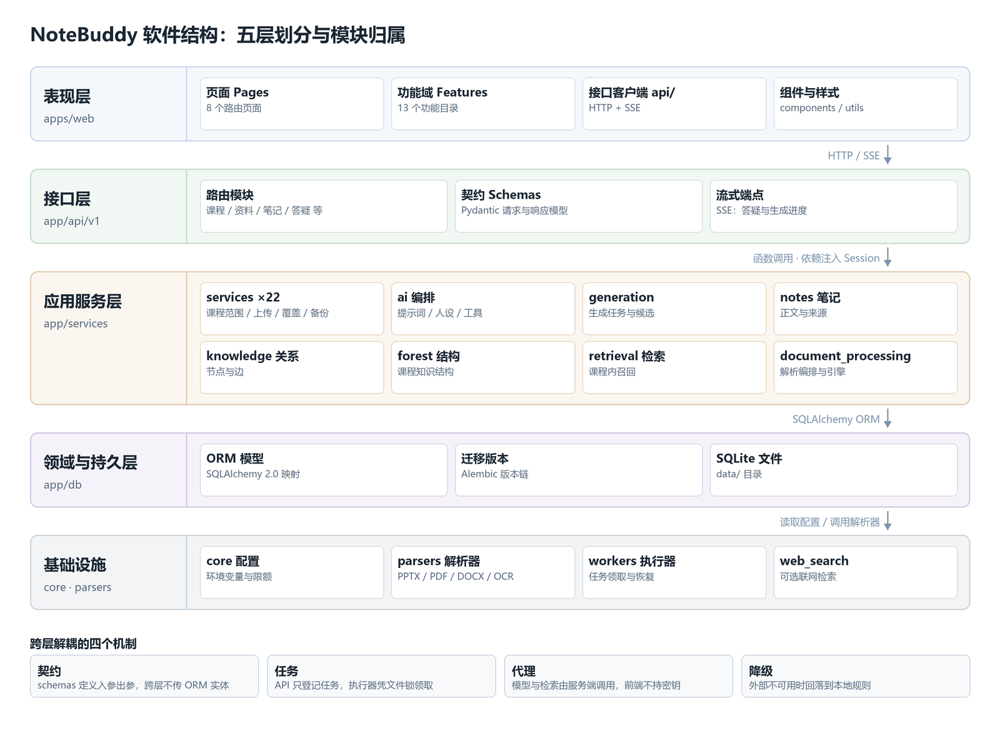
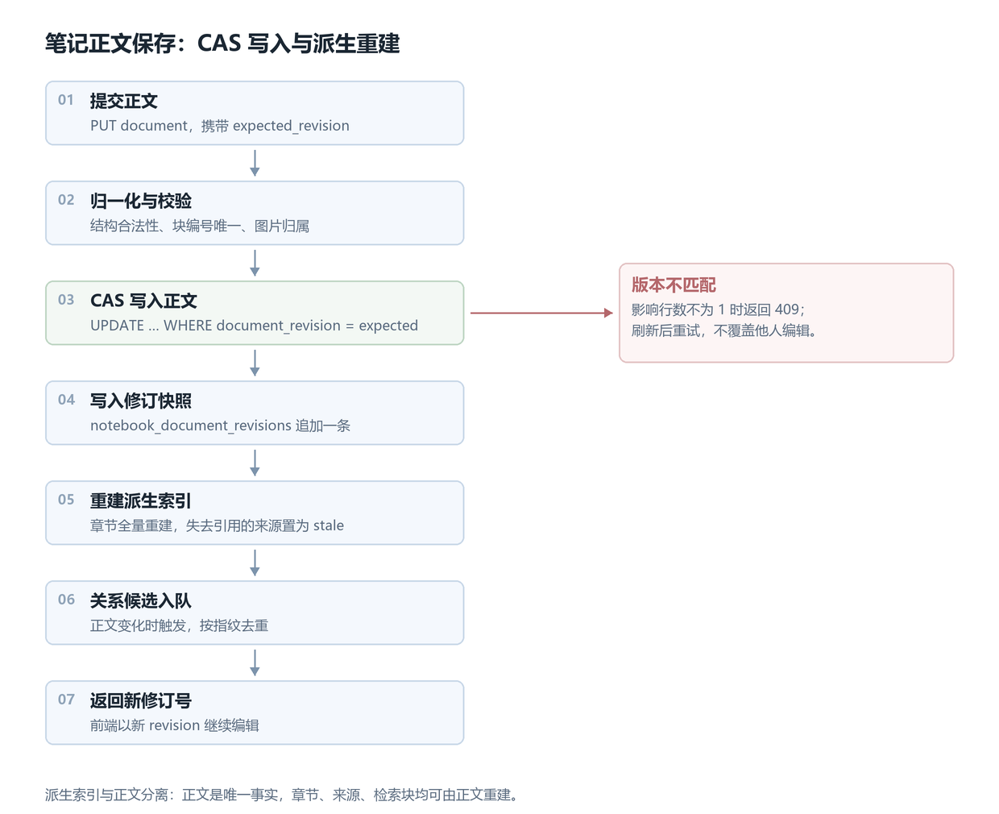

# NoteBuddy 软件工程概要设计

| 项目   | 内容                                   |
| ---- | ------------------------------------ |
| 文档版本 | v0.6（第 1–4 章）                        |
| 代码基线 | `feat/overall-inspection`（`9d5d118`） |
| 更新日期 | 2026-11-03                           |
| 说明   | 按《软件工程概要设计》模板组织                      |

---

## 1 系统概述

### 1.1 系统简介

#### 1.1.1 基本情况

NoteBuddy 是面向大学生的课程学习辅助工具，以本地网页应用的形式交付。用户按课程上传 PPTX、PDF、DOCX 课件，系统解析后提炼重点、解释难点，生成可按讲次顺序整本阅读的课程笔记，并以一棵可交互的知识树组织笔记入口与知识联系；应用内桌宠结合当前课程与阅读位置提供答疑。

系统在一台计算机上运行，由浏览器界面、本地业务服务、资料解析与 AI 处理模块、本地存储四部分组成。课程、资料、笔记、知识树与对话数据全部保存在本机；大语言模型是唯一需要联网的外部依赖，由本地服务统一代理调用。首期按单用户、单终端、单浏览器会话规划，不建设账号体系、教师端与多用户协作，也不要求部署上线。

功能范围围绕一条学习闭环组织：建课、上传、生成、阅读、查漏补缺、答疑、继续上传。首批交付九项功能，即课程书架与资料管理、资料上传与解析、重点提炼与难点解释、课程笔记本、知识树与关系更新、逐页覆盖总览、选页补生成、应用内答疑桌宠、AI 处理与本地配置。测验、闪卡、播客、音视频转写、跨课程知识森林、在线部署与多用户体系不在首期范围内。

从实现形态看，系统采用前后端分离的单机结构：前端为 React 19、TypeScript 与 Vite 构建的浏览器应用；后端为 Python 3.12、FastAPI 与 SQLAlchemy 2.0 的本地服务；数据存于本地 SQLite 数据库与文件目录，表结构由 Alembic 迁移管理；另有一个 Electron 桌面外壳，承担窗口加载与打包，业务能力由本地服务提供。

#### 1.1.2 背景

课程学习的主要材料是教师下发的电子课件。课件本质上是讲稿而非读物：单页信息稀疏、要点分散、难点没有标注、跨讲概念之间缺少联系，学生复习时需要重读全部幻灯片，也难以把同一概念在不同讲次串起来。通用聊天工具不了解课程范围与当前页面，回答无法回溯出处；笔记软件、AI 对话与课件阅读器各解决一段，彼此不衔接。

本系统因此以课件页为最小来源单位，让每段笔记都能回溯到具体讲次与页码，由知识树承担跨讲串联，由桌宠在阅读现场回答具体问题。

#### 1.1.3 术语

下表列出本文件反复使用的术语。

| 术语      | 含义                                         |
| ------- | ------------------------------------------ |
| 课程与讲次   | 课程是学习组织单位，讲次是课内授课单元，资料按讲次归档                |
| 资料页     | 课件中的可定位单位（幻灯片、PDF 页或 DOCX 固定分页），编号在一次导入内稳定 |
| 课程笔记    | 一门课的可编辑正文，按讲次与课件顺序组织；首期一门课对应一本             |
| 知识节点与叶子 | 节点代表知识点，叶子是节点下指向某段笔记的入口；同一知识点跨讲保留各自叶子      |
| 关系      | 节点间带类型的连线，表示重复出现、进一步讲解、前置依赖等较强联系           |
| 来源映射    | 笔记与资料页的对应记录，用于回溯出处、计算覆盖与校验生成结果             |
| 覆盖      | 某资料页是否已有笔记来源，分已收录、未收录、解析失败；仅用于检查，不代表内容完整   |
| 补生成     | 用户选定未收录页后，按页重新提炼并插入笔记的增量生成过程               |
| 桌宠      | 应用内答疑助手，只回答问题、不修改笔记；引用课程内容时附带出处            |

### 1.2 系统目标

总目标是打通"课件 → 可读笔记 → 可检索知识结构 → 阅读现场答疑"这条链路，并在单机本地条件下保证数据可追溯、可编辑、可增量更新。

**功能目标**

1. **流程可用**：建课、上传、解析、生成、阅读、查漏补缺、答疑、再上传构成完整闭环，九项功能各有明确的输入、处理结果与可观察反馈。
2. **来源可追溯**：每段笔记可定位到具体资料与页码；覆盖状态由来源映射计算，不靠人工标记；生成结果须通过来源与端点校验后才写入。
3. **编辑不丢失**：用户修改按修订版本保存；重新处理资料不静默覆盖；补生成只新增，或在用户明确确认后替换。
4. **增量更新**：新增讲次只追加对应节点、叶子与关系，不改动既有笔记入口与用户编辑。
5. **失败可收敛**：任务失败保留此前可用数据，不产生"有叶子无笔记"的记录；每类失败给出原因与重试入口。
6. **能力可降级**：模型不可用或未配置时，浏览、目录、知识树、覆盖总览继续可用，AI 功能明确标注受限。

**性能目标**

1. **阅读不依赖模型**：目录定位、叶子跳转、笔记保存直接读写本地数据，不触发模型调用。
2. **长任务异步**：解析与生成由后台执行器处理，请求只登记任务即返回；解析期间仍可浏览既有内容与提问。
3. **答疑流式输出**：模型支持时以事件流逐条推送，先出首段再逐步补全。
4. **外部调用受控**：模型请求超时默认 60 秒，联网检索超时默认 20 秒，失败只做有限重试。
5. **输入有上限**：单文件默认 50 MB、单份资料 500 页，直读模式为 200 MB / 2000 页，超限在受理阶段拒绝并说明原因。

### 1.3 运行环境

#### 1.3.1 运行环境要求

| 项目    | 要求                                                                                                            |
| ----- | ------------------------------------------------------------------------------------------------------------- |
| 操作系统  | Windows 10/11 桌面系统，单机单用户运行                                                                                    |
| 硬件    | 普通笔记本或台式机；内存建议 8 GB 起，磁盘需为原始课件、派生文件与备份预留空间                                                                    |
| 浏览器   | 现代桌面浏览器访问 `http://localhost:5173`，移动端不作适配                                                                     |
| 后端运行时 | Python 3.12，FastAPI + Uvicorn，监听 `127.0.0.1:8000`                                                             |
| 前端运行时 | Node.js 22.12 及以上（含 npm），Vite 开发服务器占用 5173                                                                    |
| 数据存储  | 本地 SQLite 单文件数据库，结构由 Alembic 迁移管理                                                                             |
| 数据目录  | 默认 `./data`，下分 `originals`（原始文件）、`derived`（解析与预览派生）、`backups`（备份）、`logs`（运行日志）；可用环境变量 `NOTEBOOK_DATA_DIR` 改位置 |
| 外部服务  | 大语言模型 API（默认 DeepSeek 兼容接口），可选联网检索 API；两项均未配置时降级为本地规则与关键词检索                                                   |

#### 1.3.2 启动方式

`scripts/setup.ps1` 负责准备运行环境：以 uv 安装 Python 3.12、准备 Node 运行时，依赖统一放在仓库内 `.runtime` 目录，不污染系统环境。`scripts/dev.ps1` 负责一键启动，顺序为数据库迁移、资料执行器、API 服务、Web 服务，其中执行器负责领取并推进上传任务；健康检查地址为 `http://localhost:8000/api/v1/health`，启动日志写入 `data/logs/`。8000 或 5173 被占用时脚本直接退出，不做端口漂移。

#### 1.3.3 开发环境

后端为 Python 3.12 + FastAPI 0.115 + SQLAlchemy 2.0.36 + Alembic，测试用 pytest；前端为 React 19.1 + TypeScript 5.9 + Vite 7.1，测试用 Vitest；桌面壳为 Electron，承担窗口加载与打包，业务能力由本地服务提供。项目为 monorepo，`apps/backend`、`apps/web`、`apps/desktop` 各自独立构建，通过 HTTP 与 SSE 通信。

---

## 2 总体结构设计

### 2.1 软件结构

**分层。** 系统分五层：表现层（`apps/web`）、接口层（`app/api/v1`）、应用服务层（`services`、`ai`、`generation`、`notes`、`knowledge`、`forest`、`retrieval`、`document_processing`）、领域与持久层（`app/db`）、基础设施（`core`、`parsers`、`workers`、`web_search`）。调用只沿自上而下方向：页面经 HTTP/SSE 到接口层，接口层调用服务函数并注入数据库会话，服务层经 SQLAlchemy 访问持久层。

*图 2-1　软件结构：五层划分与模块归属*

**模块。** 十个模块对应九项功能：M1 课程与书架、M2 资料接入、M3 文档解析、M4 笔记生成、M5 课程笔记、M6 知识结构、M7 覆盖总览、M8 选页补生成、M9 答疑桌宠、M10 配置与运行。M2 与 M3 拆开是因为受理与落盘在请求进程完成，解析由执行器在后台完成。模块对外暴露少量函数式接口，例如 `ingest_document`、`create_generation_job`、`save_notebook_document`、`material_coverage`、`run_agent`、`compose`、`add_relation`；跨模块传 ID 与 DTO，不传 ORM 实体。

**耦合。** 解耦靠四点：`schemas` 定义跨层契约；执行器凭任务表与操作系统文件锁独立运行；模型与检索只在服务端调用；外部不可用时降级为本地规则。

---

### 2.2 设计思想

这张图的五层划分更像是给每类不确定性划边界：界面处理交互，接口处理协议，服务层处理业务编排与模型调用，持久层处理一致性，基础设施处理外部依赖。一句话概括——**把不确定的交给模型，把确定的留给代码**。由此有五条原则。

**一、来源优先。** 资料页是系统中最小、最稳定的坐标。页标识在导入时一次生成、此后不再变动，笔记、覆盖状态、知识树叶子都以它为锚点，因此任何一段内容都能回答"出自哪份资料的哪一页"。

**二、单一正文源。** 可编辑正文只有 `Notebook.document_json` 一份，章节、检索块、树目录都是它的派生，可随时重建（`rebuild_notebook_sections`、`rebuild_all`）。写入时携带 `expected_revision` 做版本校验，冲突直接拒绝，避免两处编辑互相覆盖。

**三、先规划后生成。** 生成前先用确定性规则算出"哪些知识单元要新增、哪些已覆盖应跳过"，计划随任务落库（`generation/planner.py`），模型只负责填充内容。这样"是否重复"由代码判断而非模型自证；公式另过一遍纯函数检查（`quality_gate.py`），不依赖模型保证正确。

**四、建议制而非直写。** 答疑工具集是只读的，`agent_tools.py` 明确不提供正文编辑工具；Agent 若要改笔记，只能生成待确认的编辑建议，用户采纳后才落到正文。这与"桌宠只回答、不改笔记"的需求一致。

**五、失败可收敛。** 上传与生成都是任务：请求只登记并返回标识，执行器凭文件锁领取，步骤结果写检查点（`checkpoints.py`），重复提交靠 `Idempotency-Key` 去重。任一步失败都保留此前可用数据，不留"有叶子无笔记"的半成品。

---

## 3 模块设计

系统按业务划分为十个模块，覆盖需求九项功能：M2 与 M3 由"资料上传与解析"拆分而来（受理与解析分处两个进程），M10 为支撑模块，其余与功能一一对应。各模块篇幅不等：自己建数据表、处理分支多、出错影响大的想写；只做查询或直接复用其他模块流程的略写。

| 编号   | 模块    | 主要功能                    | 主要接口                                                  |
| ---- | ----- | ----------------------- | ----------------------------------------------------- |
| 3.1  | 课程与书架 | 建课、改课、删除确认、课程总览         | `POST /courses`、`GET /courses/{id}/overview`          |
| 3.2  | 资料接入  | 上传受理、批次管理、落盘与去重         | `POST /notebooks/{id}/assets`                         |
| 3.3  | 文档解析  | 按页提取文本与结构、表格公式识别、OCR 降级 | 执行器内部调用，状态见 `GET /jobs/{id}`                          |
| 3.4  | 笔记生成  | 规划知识单元、生成正文与难点解释、四道校验   | `POST /notebooks/{id}/generation-jobs`                |
| 3.5  | 课程笔记  | 正文读写、章节与来源查询、修订恢复       | `GET/PUT /courses/{cid}/notebooks/{id}/document`      |
| 3.6  | 知识结构  | 知识点与关系、树结构、提议审核         | `GET /courses/{id}/knowledge-graph`                   |
| 3.7  | 覆盖总览  | 按页统计已引用、待复核与解析质量        | `GET /materials/{id}/coverage`                        |
| 3.8  | 选页补生成 | 按资料范围发起增量生成             | `POST /notebooks/{id}/generation-jobs`（携 `asset_ids`） |
| 3.9  | 答疑桌宠  | 课程内检索、工具调用、流式回答与出处      | `POST /conversations/{id}/agent-messages`             |
| 3.10 | 配置与运行 | 健康检查、配置读写、任务查询、备份恢复     | `GET /health`、`GET/PATCH /settings`                   |

### 3.1 课程与书架

#### 3.1.1 功能描述

课程是系统的最高组织单位，一门课对应书架上一个入口，其下挂笔记本、资料、会话与知识节点。本模块负责新建课程、书架列表（按最近打开排序）、课程信息修改、进入课程并记录打开时间、课程总览、删除前的影响预览、软删除至回收站与恢复。

#### 3.1.2 接口描述

| 接口                                   | 输入               | 输出                          | 异常       |
| ------------------------------------ | ---------------- | --------------------------- | -------- |
| `POST /courses`                      | name、description | 课程对象                        | 名称为空 422 |
| `GET /courses`                       | —                | 课程列表（含资料与笔记计数）              | —        |
| `PATCH /courses/{id}`                | name、description | 更新后的课程                      | 不存在 404  |
| `POST /courses/{id}/visit`           | —                | 最近打开时间                      | 不存在 404  |
| `GET /courses/{id}/overview`         | —                | 资料、笔记、节点汇总                  | 不存在 404  |
| `GET /courses/{id}/deletion-preview` | —                | 受影响资料数、页数、来源引用数、占用字节、运行中任务数 | 不存在 404  |
| `DELETE /courses/{id}`               | —                | 删除结果与检查点位置                  | 不存在 404  |
| `GET /courses/deleted`               | —                | 回收站课程列表                     | —        |

#### 3.1.3 数据结构描述

`courses` 表：`id`、`name`、`description`、`created_at`、`deleted_at`、`notebook_order_revision`、`last_opened_at`，一对多关联 `notebooks`、`materials`、`conversations`、`knowledge_proposals`、`knowledge_changes`、`feedback`。

删除预览返回 `materials`、`pages`、`source_refs`、`document_blocks`、`original_bytes`、`active_jobs`、`action`。

#### 3.1.4 实现思路

删除采用软删除：写 `deleted_at` 而非物理删除，所有查询统一过滤该字段，恢复时清零。删除前先统计级联范围，再向 `backups/` 生成一份以时间戳命名的数据检查点，最后标记删除，使误删可回溯。

课程归属不在各表重复维护，而由 `course_scope` 提供换算函数：从笔记本、资料、资产反查所属课程，供其他模块做越权校验。

#### 3.1.5 其他

以 REST 服务形式运行于本地后端进程，无独立后台任务。人机界面为书架页，卡片式陈列课程入口。

### 3.2 资料接入

#### 3.2.1 功能描述

承接用户上传的课件，完成受理、校验、落盘、去重与任务登记。支持单文件与多文件批次；讲次名称默认取文件名并可修改；文件落盘后生成资料记录并登记解析任务，由执行器异步处理。另负责资料附件的查看、内联与删除。

#### 3.2.2 接口描述

| 接口                                                   | 输入                                                  | 输出        | 异常                                   |
| ---------------------------------------------------- | --------------------------------------------------- | --------- | ------------------------------------ |
| `POST /notebooks/{id}/assets`                        | 文件、lecture_title、processing_route、`Idempotency-Key` | 资料对象与任务标识 | 类型不支持 415、超限 413、重复文件 409、未指定笔记本 422 |
| `POST /notebooks/{id}/upload-batches/{bid}/complete` | 批次号                                                 | 批次完成状态    | 批次不存在 404                            |
| `GET /notebooks/{id}/assets`                         | —                                                   | 资料列表与解析状态 | 笔记本不存在 404                           |
| `DELETE /notebooks/{id}/assets/{aid}`                | —                                                   | 删除结果      | 不存在 404                              |

#### 3.2.3 数据结构描述

`assets` 表：`source_type`、`media_type`、`mime_type`、`extension`、`original_name`、`storage_key`、`byte_size`、`sha256`、`upload_batch_id`、`state`、`verified_at`；`storage_key` 唯一，指向 `data/originals/` 下的实体文件。

`materials` 表：`notebook_id`、`course_id`、`asset_id`、`lecture_title`、`topic_title`、`size_bytes`、`status`、`page_count`、`content_hash`、`parser_version`、`processing_route`、`chapter_order`、`deleted_at`。

`notebook_upload_batches` 记录批次与关闭时间；`processing_jobs` 记录任务状态、阶段、已处理页数与错误码。

#### 3.2.4 实现思路

上传按流式处理：边写临时文件边计算 SHA-256，超过路由限额立即中断；写完后校验容器结构是否与扩展名相符，防止改后缀绕过。

去重分两层。请求幂等键按"笔记本 + 路由 + 键"散列后查任务表，命中则直接返回原任务；内容层用 SHA-256 与该笔记本既有资料比对，相同文件默认拒绝，用户确认后可作新讲次导入。两层校验都在取得数据库写锁后复查，避免并发重复提交。

落盘使用"临时文件 + 原子替换"，保证 `originals` 中不出现半截文件；章节序号在写锁内取当前最大值加一，与其他上传和排序操作串行。

#### 3.2.5 其他

请求进程只负责受理与落盘，解析交由执行器领取，因此上传接口在文件写入完成后即返回。人机界面为资料页，支持拖拽上传与批次进度。

### 3.3 文档解析

#### 3.3.1 功能描述

把已落盘的课件转换成结构化文本。按文件格式选择解析引擎，逐页提取正文、标题层级与版式信号，识别表格、图片、公式与代码，产出统一的中间表示。解析时逐页记录状态：能识别的页标记已解析，不能识别的页标记失败并给出告警，不以空内容冒充成功。

#### 3.3.2 接口描述

本模块不对外暴露 HTTP 端点，由执行器在任务中调用：

| 接口                  | 输入        | 输出         | 异常          |
| ------------------- | --------- | ---------- | ----------- |
| `create_parse_run`  | 资产标识、解析配置 | 解析运行记录     | 格式不支持 415   |
| `execute_parse_run` | 运行标识      | 页与块数据、质量告警 | 文件不可读、解析器异常 |
| `load_ir`           | 运行标识      | 页、节、块结构    | 运行不存在 404   |
| `current_run`       | 资产标识      | 当前有效运行     | 无可用运行时为空    |

任务状态经 `GET /jobs/{id}` 对外查询，包含阶段、已处理页数与错误码。

#### 3.3.3 数据结构描述

`document_parse_runs`：`asset_id`、`document_id`、`doc_type`、`ir_version`、`status`、`parser_name`、`parser_version`、`config_version`、`is_current`。

`document_pages`：`logical_page_id`、`parse_run_id`、`page_number`、`width`、`height`、`render_key`、`extraction`、`status`、`text`。`logical_page_id` 在一次导入内稳定，是全系统引用页面的依据。

`document_blocks`：`parse_run_id`、`page_id`、`block_id`、`parent_block_id`、`order`、`global_order`、`block_type`、`level`。

中间表示由 `PageIR`、`SectionIR`、`BlockIR`、`TableData`、`FigureData`、`SourceSpan` 组成，是解析与生成之间的交换格式。

#### 3.3.4 实现思路

解析按"运行"组织：每次解析创建一条运行记录，完成后置为当前版本，旧运行保留以便回溯。页面与文本块按运行隔离，同一份资料多次解析不会互相覆盖。

路由分两条：`standard` 使用本地解析器处理 PPTX、PDF 与 DOCX；`llm` 走视觉模型直读，适合版式复杂或文字层缺失的文件，两条路由的限额不同。图片型页面无法提取文字时转 OCR，仍失败的页写入告警而非空文本。

已完成的模型调用结果按步骤落检查点，同一任务重试时可复用。

#### 3.3.5 其他

运行于执行器进程，无独立界面。解析状态与失败页在资料页呈现，用户可据此换文件或改用直读路由。

### 3.4 笔记生成

#### 3.4.1 功能描述

把解析结果转成可阅读的课程笔记。生成前先规划哪些知识单元需要新增、哪些已覆盖应跳过；随后按单元调用模型，产出正文与难点解释，附来源映射，校验通过后追加到对应讲次位置。支持重试、取消与幂等提交。

#### 3.4.2 接口描述

| 接口                                     | 输入                            | 输出          | 异常                   |
| -------------------------------------- | ----------------------------- | ----------- | -------------------- |
| `POST /notebooks/{id}/generation-jobs` | `asset_ids`、`Idempotency-Key` | 任务对象（202）   | 笔记不存在 404、无可生成输入 422 |
| `GET /notebooks/{id}/generation-jobs`  | —                             | 任务列表        | —                    |
| `GET …/{jid}`                          | —                             | 任务状态与阶段     | 任务不存在 404            |
| `POST …/{jid}/retry`                   | —                             | 重置后的任务（202） | 任务不存在 404            |
| `POST …/{jid}/cancel`                  | —                             | 取消结果        | 任务不存在 404            |

#### 3.4.3 数据结构描述

`notebook_generation_jobs`：`notebook_id`、`idempotency_key`、`request_fingerprint`、`status`、`base_document_revision`、`input_snapshot_json`、`model`、`prompt_version`、`schema_version`、`attempt_count`、`error_code`、`error_message`。

`input_snapshot_json` 保存生成时的资料、页面与来源快照，重试时据此复现输入；`notebook_generation_candidates` 保存生成结果与审核状态，`notebook_generation_inputs` 记录任务输入单元。

#### 3.4.4 实现思路

生成分两步。第一步是确定性规划：按资料页与已有正文算出知识单元清单，标注新增、扩展或跳过，计划随任务落库，使"是否重复"由代码判断。第二步才是模型生成：按单元组装上下文、控制单次输入长度，产出结构化正文而非自由文本。

正文要过四道校验：结构归一化、公式纯函数检查（括号与环境配对、禁用命令）、来源映射校验（每个块必须指向有效页与块）、图片拒绝（生成正文不含图片）。

写入前比对 `base_document_revision`，若用户在生成期间编辑过笔记，任务不覆盖，改为提示重新生成。

#### 3.4.5 其他

运行于执行器进程，接口只负责任务登记。界面在笔记页展示任务进度与新增内容位置，生成期间用户可继续阅读既有正文。

### 3.5 课程笔记

#### 3.5.1 功能描述

课程笔记的正文容器。按讲次与课件顺序组织内容，支持整本连续阅读、目录定位与章节跳转；用户可直接编辑并自动保存；每次保存形成修订记录，可查看历史并恢复；任意一段正文可反查出自哪份资料的哪一页；离开页面时记录阅读位置。

#### 3.5.2 接口描述

| 接口 | 输入 | 输出 | 异常 |
|---|---|---|---|
| `GET /courses/{cid}/notebooks/{id}/document` | — | 文档结构与当前修订号 | 笔记不存在 404 |
| `PUT /courses/{cid}/notebooks/{id}/document` | 文档结构、`expected_revision` | 新修订号与文档 | 版本冲突 409、结构非法 422 |
| `GET …/notebooks/{id}/sections` | — | 章节列表 | 404 |
| `GET /notebooks/{id}/blocks/{bid}/sources` | — | 该块的来源页与定位 | 块不存在 404 |
| `GET …/revisions` | 分页参数 | 修订列表 | — |
| `POST …/revisions/{rev}/restore` | — | 恢复后的新修订 | 修订不存在 404 |

#### 3.5.3 数据结构描述

`notebooks`：`document_json`（正文唯一来源）、`document_revision`（当前修订号）、`order_revision`（章节顺序版本）。

`notebook_sections`：由正文派生的章节索引，含标题、所属资料与页锚点，供目录与叶子跳转。`notebook_document_revisions`：`revision`、`document_json`、`origin`（autosave / restore / generation）、`created_at`。`notebook_block_sources`：块与解析页、来源块的映射，是覆盖计算与出处显示的依据。`notebook_reading_positions` 记录阅读位置。

#### 3.5.4 实现思路

正文以文档树形式整份存取，不做逐块增量更新，避免块级合并带来的顺序错乱。保存流程见图 3-1：先归一化并校验结构，再以修订号做比较并交换（CAS）写入，影响行数不为 1 即判定并发冲突；写入成功后记录修订快照、全量重建章节索引、把失去引用的来源置为失效，并在正文确有变化时触发关系候选重算。

章节、来源映射、检索块均为派生数据，可随时由正文重建，因此重建失败不会损坏正文；反之，任何绕过正文直接改派生表的写入都不被允许。

页面保存采用自动保存与显式保存并行，两者都携带当前修订号；冲突时前端提示刷新，不静默覆盖。

*图 3-1　笔记正文保存：CAS 写入与派生重建*

#### 3.5.5 其他

以 REST 服务运行，编辑在浏览器内完成，保存请求由本地服务处理。人机界面为三栏笔记页：左侧目录、中间正文、右侧答疑坞，正文区支持公式与代码渲染。

### 3.6 知识结构

#### 3.6.1 功能描述

维护课程的知识点与知识点之间的联系。节点保存名称与摘要，边保存关系类型与置信度；知识结构以层级方式组织，供知识树视图与叶子跳转使用。正文新增或修改后，系统重算可能的关系并以提议形式提交，用户确认后才写入关系表。

#### 3.6.2 接口描述

| 接口 | 输入 | 输出 | 异常 |
|---|---|---|---|
| `GET /courses/{id}/knowledge-graph` | — | 节点与边 | 课程不存在 404 |
| `GET /courses/{id}/knowledge-structure` | — | 层级结构 | 404 |
| `GET /courses/{id}/knowledge-proposals` | 状态筛选 | 待审提议列表 | 404 |
| `POST /knowledge-proposals/{pid}/review` | decision、note | 审核后的提议 | 提议不存在 404、已审 409 |
| `GET /courses/{id}/knowledge-changes` | — | 变更记录 | 404 |
| `GET /forest/courses/{id}/tree` | — | 课程知识树 | 404 |

#### 3.6.3 数据结构描述

`knowledge_nodes`：`course_id`、`name`、`summary`、`status`。`knowledge_edges`：`source_node_id`、`target_node_id`、`relation_type`、`confidence`、`created_by`；关系类型区分重复出现、进一步讲解、前置依赖等，`created_by` 标明由系统提议还是用户建立。

`knowledge_proposals` 保存待审提议，`knowledge_changes` 保存变更流水；`notebook_relations` 与 `notebook_relation_suppressions` 分别保存笔记间关系与用户已否决的组合，避免同一提议反复出现。

#### 3.6.4 实现思路

关系不从关键词匹配直接生成。正文变更后，先按章节抽取可比较的内容片段并计算指纹，指纹相同的片段不重复送模型；模型只判断两者是否存在较强联系及类型，返回结果再经端点校验：两端节点必须存在、属于同一课程，同一对端点同一类型不得重复建边。

判定结果不直接落库，而是写入提议表等待审核。用户接受后建边并记录变更，拒绝则写入抑制表，后续生成跳过该组合。这样模型的不确定判断不会污染已确认的知识结构。

#### 3.6.5 其他

以 REST 服务运行，关系重算由执行器异步完成。人机界面为知识树视图，节点可展开收起，叶子点击进入对应笔记章节，待审提议在侧栏集中处理。

### 3.7 覆盖总览

#### 3.7.1 功能描述

按页展示某份资料的收录状态：该页是否已有笔记引用、是否属待复核、解析是否失败，并可查看该页关联的笔记。状态由来源映射实时计算，不单独存储。

#### 3.7.2 接口描述

`GET /materials/{id}/coverage`、`GET /assets/{id}/document/coverage`。返回总页数、已引用页数、待复核页数、逐页明细与解析质量；资料未解析时返回 pending，且不开放生成。

#### 3.7.3 数据结构描述

返回体含 `total_locations`、`cited_locations`、`review_locations`、`locations[]`（页号、块、引用数、状态）与 `quality_status`，不新增表。

#### 3.7.4 实现思路

只读聚合：以当前解析运行的页与块为基表，左连接来源映射，按页统计引用数；有引用记为已引用，无引用记为待复核。解析未完成时不合成状态。

#### 3.7.5 其他

REST 查询，无后台任务。界面为覆盖总览页，原资料页与状态并排显示，可勾选页面发起补生成。

### 3.8 选页补生成

#### 3.8.1 功能描述

对用户选定的资料范围发起增量生成，把新增内容插入对应讲次，写入成功后覆盖状态随之变化。重复提交按幂等键归并，不产生重复笔记。

#### 3.8.2 接口描述

复用 `POST /notebooks/{id}/generation-jobs`，请求体以 `asset_ids` 指定范围，成功返回 202 与任务标识；状态查询、重试、取消与 3.4 相同。

#### 3.8.3 数据结构描述

与生成模块共用任务表与候选表，不另建结构；覆盖状态仍由来源映射推导，不写冗余字段。

#### 3.8.4 实现思路

与 3.4 同一条任务通道，差异在输入范围与落点：只取指定资料的页，按讲次顺序确定插入锚点，写入沿用同一套校验与版本比对。只有正文与来源都保存成功，覆盖状态才随之改变。

#### 3.8.5 其他

入口在覆盖总览页，选中页面后触发；执行仍在后台，界面显示任务状态。

### 3.9 答疑桌宠

#### 3.9.1 功能描述

应用内问答。先检索本课程的资料与笔记，结合当前阅读位置组织回答，按事件流逐步输出；引用课程内容时标注出处，课外补充与课程依据分开呈现。

#### 3.9.2 接口描述

`POST /conversations/{id}/agent-messages`（SSE 流式）、`POST /courses/{id}/assistant`。事件类型包括文本增量、工具调用、出处与错误；会话不存在返回 404。

#### 3.9.3 数据结构描述

`conversations` 记录所属课程或笔记，`conversation_messages` 记录角色、内容与时间，`message_evidence` 以 `source_ref_id`、`web_source_id`、`evidence_type`、`support_level` 把回答与来源绑定。

#### 3.9.4 实现思路

采用有限轮次的工具调用循环，最多 6 轮：每轮由模型决定是否检索、读页、读笔记、查覆盖或解释术语，工具结果截断后回填上下文；达到上限即停止并返回已生成内容。工具集只读，不提供正文编辑能力，改写笔记只能生成待确认建议。

#### 3.9.5 其他

常驻侧栏，默认收起，可与笔记并排；回答中的出处来自证据表，不依赖模型自述。

### 3.10 配置与运行

#### 3.10.1 功能描述

系统的运行支撑：健康检查、模型与检索配置的读写、任务状态查询、数据备份与恢复。

#### 3.10.2 接口描述

|  |  |  |
| --- | --- | --- |
`GET /health`；`GET /settings` 返回各服务的配置状态与限额，`PATCH /settings` 需携带设置口令，无口令返回 403、校验失败返回 422；`GET /jobs/{id}` 查询任务；`POST /backups/export|preview|restore` 导出、预检与恢复。

#### 3.10.3 数据结构描述

配置来自环境变量与本地 `.env`，不落业务表；`backup_records` 记录动作、路径、清单与状态，`manifest_json` 保存备份内容索引。

#### 3.10.4 实现思路

可改配置限定在白名单内，写入前先探活再落盘，避免填入不可用端点；设置口令与密钥不通过接口回显。健康检查聚合数据库、解析引擎与外部服务的可用性，供界面显示当前能力。

#### 3.10.5 其他

无独立进程，随服务启动；界面为设置页与状态指示，不涉及业务数据。

---

## 4 数据库与数据结构设计

### 4.1 数据库及数据表

系统使用 SQLite 3.53 作为嵌入式数据库，单文件存放于 `data/notebook.sqlite3`，随应用启动，不依赖独立数据库服务。数据访问经 SQLAlchemy 2.0 ORM 完成，表结构由 Alembic 迁移管理，当前共 35 个迁移版本、58 张业务表。

数据表按业务域组织如下：

| 业务域 | 主要数据表 | 作用 |
|---|---|---|
| 课程与笔记 | `courses`、`notebooks`、`notebook_sections`、`notebook_document_revisions`、`notebook_reading_positions`、`notebook_upload_batches` | 课程、笔记正文、派生的章节索引与修订 |
| 资料与资产 | `assets`、`materials`、`notebook_assets`、`notebook_attachments`、`notebook_cover_assets`、`notebook_revision_assets` | 原始文件、讲次记录、附件与引用关系 |
| 解析 | `document_parse_runs`、`document_pages`、`document_blocks`、`document_sections`、`document_chunks`、`page_blocks`、`material_pages` | 解析运行、页、文本块与检索分块 |
| 来源映射 | `notebook_block_sources`、`note_source_mappings`、`source_refs`、`note_source_refs` | 笔记块与资料页的对应关系 |
| 生成与任务 | `notebook_generation_jobs`、`notebook_generation_candidates`、`notebook_generation_inputs`、`processing_jobs`、`processing_steps` | 生成任务、候选结果、输入快照与步骤检查点 |
| 知识结构 | `knowledge_nodes`、`knowledge_edges`、`knowledge_changes`、`knowledge_proposals`、`notebook_relations`、`notebook_relation_suppressions`、`cross_course_relations` | 知识点、关系、待审提议与变更流水 |
| 会话与答疑 | `conversations`、`conversation_messages`、`message_evidence`、`web_sources`、`provider_calls` | 会话、消息、引用证据与外部调用记录 |
| 编辑建议 | `notebook_edit_suggestions`、`note_suggestions`、`note_revisions`、`notes` | 待确认的修改建议，`notes` 为兼容旧版保留 |
| 测验与复习 | `quizzes`、`quiz_items`、`quiz_attempts`、`review_artifacts`、`feedback` | 测验题、作答记录与复习产物 |
| 运行支撑 | `backup_records`、`curriculum_imports`、`forest_course_profiles`、`forest_jobs`、`asset_migration_issues`、`asset_parse_results`、`asset_processing_jobs` | 备份、课程导入与维护类任务 |

### 4.2 数据结构设计

命名与类型遵循统一约定：主键 `id` 为 36 位 UUID 字符串；外键命名为 `<实体>_id`；时间字段统一存 UTC；结构化正文以 JSON 文本存入 `Text` 字段；字符串按用途给定长度上限。

核心数据结构如下：

| 名称 | 标识符 | 主要数据项 |
|---|---|---|
| 课程 | `courses` | `id` char(36)、`name` varchar(200)、`description` text、`deleted_at` datetime、`last_opened_at` datetime |
| 笔记 | `notebooks` | `id` char(36)、`course_id` char(36)、`title` varchar(200)、`document_json` text、`document_revision` int、`order_revision` int、`is_default` bool |
| 资料 | `materials` | `id`、`notebook_id`、`course_id`、`asset_id`、`lecture_title` varchar(200)、`status` varchar(30)、`page_count` int、`content_hash` char(64)、`chapter_order` int |
| 资产 | `assets` | `id`、`storage_key` varchar(500) 唯一、`original_name` varchar(255)、`byte_size` int、`sha256` char(64)、`state` varchar(20) |
| 解析运行 | `document_parse_runs` | `id`、`asset_id`、`status` varchar(20)、`parser_name` varchar(80)、`parser_version` varchar(80)、`is_current` bool |
| 资料页 | `document_pages` | `id`、`parse_run_id`、`logical_page_id`、`page_number` int、`status` varchar(20)、`text` text |
| 文本块 | `document_blocks` | `id`、`parse_run_id`、`page_id`、`block_id` varchar(64)、`parent_block_id`、`order` int、`block_type` varchar(30) |
| 笔记章节 | `notebook_sections` | `id`、`notebook_id`、`section_id`、`title`、`material_id`、页码锚点 |
| 来源映射 | `notebook_block_sources` | `notebook_id`、`block_id`、`parse_run_id`、`page_id`、`status` |
| 生成任务 | `notebook_generation_jobs` | `id`、`notebook_id`、`idempotency_key` varchar(100)、`status`、`base_document_revision` int、`input_snapshot_json` text |
| 知识节点 | `knowledge_nodes` | `id`、`course_id`、`name` varchar(300)、`summary` text、`status` varchar(30) |
| 知识关系 | `knowledge_edges` | `id`、`course_id`、`source_node_id`、`target_node_id`、`relation_type` varchar(40)、`confidence` float、`created_by` varchar(30) |

记录之间的关系以一对多为主：课程对笔记、资料对页、解析运行对块均为 1:N；笔记块与资料页之间是多对多，由来源映射表承载，同一块可引用多页，同一页也可被多块引用。知识节点之间通过关系表构成有向图，节点与边均归属课程。

### 4.3 数据存储设计

数据分两类存放：结构化的记录进数据库，原始文件与派生文件留在磁盘。

| 存储区域 | 内容 | 访问方式 |
|---|---|---|
| `data/notebook.sqlite3` | 全部业务表 | ORM 按主键与外键索引读写，事务以会话为单位 |
| `data/originals/` | 用户上传的原始课件 | 按 `assets.storage_key` 直接寻址，整份读取 |
| `data/derived/figures/` | 解析抽取的图片与公式渲染 | 按解析运行与块编号定位 |
| `data/notebooks/<id>/images/` | 笔记内嵌图片 | 按笔记标识定位 |
| `data/backups/` | 删除前检查点与导出包 | 按时间戳命名，整包读写 |
| `data/logs/` | 启动与任务日志 | 按日期与进程号分文件追加 |
| `data/staging/` | 上传临时文件 | 写入完成后原子替换至 `originals` |
| `data/worker.lock` | 执行器互斥锁 | 进程启动时获取，退出时释放 |

存取单位：数据库以行为单位，一次编辑对应一个事务；文件以整份为单位，不做行级修改，替换时写临时文件再改名，避免读到半截内容。

索引按访问路径设置：主键与外键默认建索引，另有 69 个显式索引，其中 10 个为带条件的唯一索引，用于约束关键唯一性——一份资料同时只允许一个活动任务（`uq_processing_jobs_active_material`）、一份资产只保留一个当前解析（`uq_document_parse_runs_current`）、一门课程只允许一个默认笔记（`uq_notebooks_default`）、同一资产的活动引用唯一（`uq_notebook_assets_active_use`）。

保密方面：数据库与文件全部存放于本机，不向外同步；模型密钥与检索密钥只存于本地环境配置，不进入数据库、不写入日志；日志仅记录任务标识、状态、时间与错误类别。

---

## 待补充章节

- 第 5 章 接口设计
- 第 6 章 其他设计（安全、并发、可靠性、已知限制）
